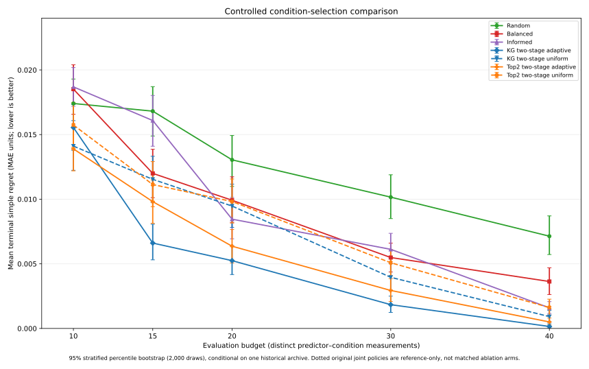

# B1 v0.1 — Complete numeric appendix for the consolidated scientific evidence

**Status:** Frozen B1 v1 retrospective development outputs; **all values transcribed from uploaded, SHA-256-verified** `budget_summary.csv` and `paired_regret_contrasts.csv`. No new bootstrap draws, tuning, hypothesis tests or independent-world inference. This appendix provides the full per-strategy intervals so the concise [scientific report](B1_CONSOLIDATED_SCIENTIFIC_EVIDENCE_V0_1.md) does not omit any decision strategy's reported uncertainty.

## A. Per-budget outcomes, including bootstrap intervals for every strategy

All entries are based on **240 randomized/seeded episodes** (20 per each of 12 starting cells) for **each** strategy at **each** budget. Every 95% interval is a 2,000-replicate **stratified within-archive episode percentile-bootstrap** interval. Mean regret and P90 regret use MAE units. Reference-best selection is the fraction of episodes recommending M3_FULL343, the lowest-mean-MAE algorithm on this historical 12-cell archive.

| Budget | Strategy | Mean regret [95% CI] | Reference-best selection [95% CI] | 90th-pct regret |
|---:|---|---|---|---:|
| 10 | Random | 0.017404 [0.015573, 0.019298] | 37.5% [32.9%, 42.5%] | 0.039058 |
| 10 | Balanced | 0.018516 [0.016572, 0.020404] | 37.1% [31.7%, 42.5%] | 0.039058 |
| 10 | Informed | 0.018690 [0.017188, 0.020182] | 35.8% [32.5%, 39.2%] | 0.040390 |
| 10 | Budget-aware Top2 | 0.015194 [0.013340, 0.016993] | 45.4% [40.4%, 50.4%] | 0.039058 |
| 15 | Random | 0.016812 [0.014890, 0.018711] | 41.3% [35.8%, 47.1%] | 0.039191 |
| 15 | Balanced | 0.011998 [0.010120, 0.013863] | 55.4% [50.0%, 60.8%] | 0.035125 |
| 15 | Informed | 0.016087 [0.014096, 0.018024] | 44.6% [39.2%, 50.4%] | 0.039058 |
| 15 | Budget-aware Top2 | 0.009799 [0.008178, 0.011357] | 57.1% [51.7%, 62.5%] | 0.035125 |
| 20 | Random | 0.013044 [0.010989, 0.014929] | 55.4% [49.6%, 61.7%] | 0.039058 |
| 20 | Balanced | 0.009917 [0.008186, 0.011734] | 58.3% [52.9%, 63.7%] | 0.035125 |
| 20 | Informed | 0.008455 [0.006935, 0.010139] | 67.5% [62.5%, 72.5%] | 0.035125 |
| 20 | Budget-aware Top2 | 0.006917 [0.005612, 0.008218] | 63.8% [58.8%, 68.8%] | 0.032265 |
| 30 | Random | 0.010159 [0.008498, 0.011890] | 55.8% [49.6%, 61.7%] | 0.035125 |
| 30 | Balanced | 0.005487 [0.004366, 0.006603] | 68.3% [63.3%, 73.3%] | 0.012061 |
| 30 | Informed | 0.006120 [0.005030, 0.007360] | 65.8% [60.4%, 70.8%] | 0.012061 |
| 30 | Budget-aware Top2 | 0.002925 [0.002078, 0.003854] | 81.3% [76.2%, 85.8%] | 0.012061 |
| 40 | Random | 0.007138 [0.005721, 0.008709] | 67.5% [62.1%, 73.3%] | 0.032265 |
| 40 | Balanced | 0.003632 [0.002624, 0.004693] | 78.8% [73.8%, 83.3%] | 0.012061 |
| 40 | Informed | 0.001592 [0.001156, 0.002078] | 87.5% [84.2%, 90.8%] | 0.012061 |
| 40 | Budget-aware Top2 | 0.000888 [0.000503, 0.001308] | 93.3% [90.4%, 96.2%] | 0.000000 |

Percentages are rounded to one decimal place; for example, 0.637500 is **63.75%**, shown as **63.8%**. Bootstrapped percentages may not be multiples of 1/240 because they are interval quantiles.

## B. Every recorded paired contrast against Balanced

Difference is **named strategy minus Balanced**; negative values favor the named strategy. Intervals are from the frozen paired/stratified, within-archive bootstrap procedure and are not adjusted for simultaneous inference.

| Budget | Strategy − Balanced | Mean regret difference | Nominal 95% episode-bootstrap interval |
|---|---|---:|---|
| 10 | Random | −0.001112 | [−0.003980, +0.001756] |
| 10 | Informed | +0.000174 | [−0.002515, +0.002808] |
| 10 | Budget-aware Top2 | −0.003321 | [−0.005992, −0.000874] |
| 15 | Random | +0.004814 | [+0.002029, +0.007647] |
| 15 | Informed | +0.004089 | [+0.001482, +0.006731] |
| 15 | Budget-aware Top2 | −0.002199 | [−0.004377, −0.000078] |
| 20 | Random | +0.003127 | [+0.000328, +0.006039] |
| 20 | Informed | −0.001463 | [−0.003791, +0.000905] |
| 20 | Budget-aware Top2 | −0.003000 | [−0.004983, −0.000869] |
| 30 | Random | +0.004673 | [+0.002336, +0.006828] |
| 30 | Informed | +0.000634 | [−0.001105, +0.002403] |
| 30 | Budget-aware Top2 | −0.002562 | [−0.003949, −0.001148] |
| 40 | Random | +0.003506 | [+0.001691, +0.005421] |
| 40 | Informed | −0.002040 | [−0.003107, −0.001007] |
| 40 | Budget-aware Top2 | −0.002743 | [−0.003805, −0.001675] |
| **Equal mean over 5 budgets** | **Random** | **+0.003002** | **[+0.001992, +0.004058]** |
| **Equal mean over 5 budgets** | **Informed** | **+0.000279** | **[−0.000609, +0.001202]** |
| **Equal mean over 5 budgets** | **Budget-aware Top2** | **−0.002765** | **[−0.003600, −0.001898]** |

## C. Data integrity and scope

The user-uploaded original `run_manifest.json` contains SHA-256 output hashes, verified against the five supplied CSVs. In particular:

- `budget_summary.csv`: `12a163b488266119f68391e96c8c63cebb4576516a312d3e48b5d4e77c657c80`.
- `paired_regret_contrasts.csv`: `2354d52108d076340100c22d97ddd966526f865753345d2493b607d099451238`.
- `terminal_episodes.csv`: `c219b700d55683899867051f3cf1f154cea54655853026c47fda814c887d9f12`.
- `seven_method_matrix.csv`: `0b58b7b6ff7489aec169a36c88a166fdb75b88e5089f14b1a610721581bb314d`.

**Do not treat these CIs as independent-world uncertainty.** All four methods are evaluated fairly on the **same fixed archive**, with the **same episode counts and bootstrap protocol**, but the policies' random action sequences need not match. WB reference-uncertainty checks are a separate experiment and are reported separately in the main report and WB freeze.

**No novel simulation, no new data, no changed estimator.**


## D. Post-result action-allocation and wrong-decision diagnostics

**Status: descriptive audit only.** These figures were calculated from the **original** `episode_action_history.csv`, `terminal_episodes.csv` and `seven_method_matrix.csv` without rerunning the B1 policies, changing any parameters or drawing another bootstrap sample. The input files were verified against the output SHA-256 values in the original `run_manifest.json`. Source fingerprints for the two detailed files are `a9412c9e07cb52e35aa6ac09e6aedd66837fca9034aabb5bb6716ac7e52d1195` (actions) and `c219b700d55683899867051f3cf1f154cea54655853026c47fda814c887d9f12` (terminal decisions).

**Retrospective share of additional observations going to the true two lowest-mean-MAE algorithms, M3_FULL343 and M2.** All four policies receive the same first seven evaluations, so those seven actions are excluded from these fractions. The denominators pool `240 × (B−7)` non-initial actions per policy/budget.

| Budget | Random | Balanced | Informed | Budget-aware Top2 |
|---:|---:|---:|---:|---:|
| 10 | 30.00% | 29.31% | 26.11% | **38.19%** |
| 15 | 27.40% | 28.44% | 27.92% | **40.94%** |
| 20 | 29.36% | 28.24% | 28.69% | **40.38%** |
| 30 | 28.66% | 28.39% | 27.19% | **47.75%** |
| 40 | 28.56% | 28.51% | 27.98% | **54.23%** |

The two best algorithms are identified **with hindsight** from the fixed 84-action archive for auditing purposes only. Top2 **does not** have oracle access to their true identities; it recomputes a posterior shortlist during each episode.

**B=20: how incorrect recommendations affect regret.** Values below condition on the strategy *not* recommending the reference-best algorithm (M3_FULL343). This is **not** a separately predeclared inference or a causal decomposition of the Top2 acquisition strategy.

| Policy | Correct recommendations / 240 | Wrong recommendations / 240 | Mean regret when wrong | Fraction recommending second-best M2 |
|---|---:|---:|---:|---:|
| Random | 133 | 107 | 0.02926 | 12.92% |
| Balanced | 140 | 100 | 0.02380 | 20.83% |
| Informed | 162 | 78 | 0.02601 | 13.33% |
| **Top2** | **153** | **87** | **0.01908** | **25.42%** |

Because correct decisions have zero simple regret, the average for each policy is its wrong-decision frequency times its mean regret *conditional on being wrong*. In this B=20 example, Top2 is slightly less likely than Informed to name the exact best, but its errors are less costly, explaining the lower mean simple regret **descriptively**.

**Recalculation from the original frozen output files (analysis only):**

```python
import pandas as pd
actions = pd.read_csv("episode_action_history.csv")
terminal = pd.read_csv("terminal_episodes.csv")
best_two = {"M3_FULL343", "M2"}
extra = actions[actions.step > 7]
for (budget, policy), sample in extra.groupby(["budget", "policy"]):
    fraction = sample.method.isin(best_two).mean()
    print("extra_to_best_two", budget, policy, round(100*fraction, 2))
for policy, sample in terminal[terminal.budget == 20].groupby("policy"):
    failures = sample[sample.correct == 0]
    print("B20_errors", policy, len(failures),
          "conditional_regret", failures.simple_regret.mean(),
          "M2_rate", (sample.recommended == "M2").mean())
```

Run this from the archived B1 replay output directory, **read-only**. This code computes no new simulation, policy run or bootstrap. The two sets of diagnostics were selected *after* viewing the original outcomes, so they are **explanatory observations, not independent tests of the hypothesized mechanism**.


---

## Supplementary numerical appendix — matched two-stage condition selection (6 November 2026)

**Separate experiment; not a reanalysis of the frozen four-policy primary contrast.** The exact full-precision, 20-policy/budget summary is [controlled_budget_summary.csv](results/controlled_condition_ablation_v1/controlled_budget_summary.csv); the paired contrasts and interval endpoints are [controlled_paired_contrasts.csv](results/controlled_condition_ablation_v1/controlled_paired_contrasts.csv). The [dedicated methods/results report](B1_CONTROLLED_CONDITION_SELECTION_RESULTS_2026-11-06.md) defines the new two-stage arm selectors and distinguishes them from the original joint-action KG and Top2 policies.

| Evaluation budget | KG two-stage adaptive | KG two-stage uniform | Top2 two-stage adaptive | Top2 two-stage uniform |
|---:|---:|---:|---:|---:|
| 10 | 0.015545 | 0.014109 | 0.013893 | 0.015741 |
| 15 | 0.006605 | 0.011537 | 0.009811 | 0.011136 |
| 20 | 0.005245 | 0.009470 | 0.006362 | 0.009822 |
| 30 | 0.001839 | 0.003957 | 0.002938 | 0.005085 |
| 40 | 0.000151 | 0.000917 | 0.000503 | 0.001621 |
| **Mean over budgets** | **0.005877** | **0.007998** | **0.006701** | **0.008681** |

**Paired uniform minus adaptive regret** (positive favors adaptive):

| Budget | KG mean difference [95% interval] | Top2 mean difference [95% interval] |
|---:|---|---|
| 10 | −0.001436 [−0.003847, 0.000851] | 0.001848 [−0.000111, 0.003719] |
| 15 | 0.004931 [0.002624, 0.007201] | 0.001325 [−0.000937, 0.003549] |
| 20 | 0.004225 [0.002397, 0.006171] | 0.003460 [0.001431, 0.005529] |
| 30 | 0.002118 [0.000936, 0.003263] | 0.002147 [0.000868, 0.003345] |
| 40 | 0.000766 [0.000302, 0.001280] | 0.001119 [0.000486, 0.001806] |
| **Mean over five budgets** | **0.002121 [0.001281, 0.002960]** | **0.001980 [0.001202, 0.002819]** |

The primary plotted series and all bounds come from the archived CSVs. Every budget/policy uses 240 episodes (12 starts × 20 repetitions), with 2,000 **within-archive, stratified percentile-bootstrap** draws for marginal and paired intervals. No independent-world resampling, multiplicity correction, or new physical simulation was performed. Original KG/Top2 joint-acquisition results cannot be used as matched condition-choice counterfactuals.



The additional [nine-policy reference plot](results/controlled_condition_ablation_v1/b1_nine_policy_with_historical_refs_ci_v1.svg) includes the original joint-action KG/Top2 implementations as distinct historical comparators.
