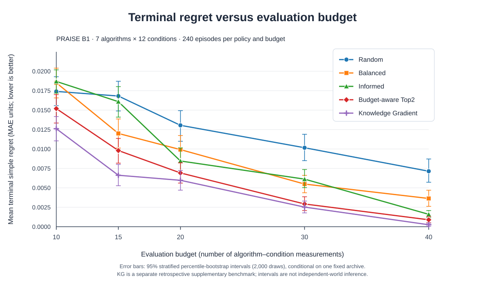

# B1: Sequential Evaluation Under Fixed Validation Budgets
## Consolidated scientific evidence report — v0.1

**PRAISE Plan B · 5 November 2026**  
**Status:** Complete *retrospective development* result on the frozen seven-method, twelve-condition archive, with separately completed white-box reference-robustness checks. **Not an independent-world confirmation or a novelty claim.**  
**Purpose:** A minimal-narrative, evidence-first scientific record. This document introduces **no new methods, experiments, simulations, outcome definitions or tuning**.

**Complete numeric companion:** [all four policies' bootstrap intervals and every paired comparison](B1_CONSOLIDATED_NUMERIC_APPENDIX_V0_1.md).

### Abstract

We study a finite-budget decision problem: when several service-compliance prediction algorithms must be compared across different provider configurations and service-composition graphs, which algorithm should be selected after observing only a limited number of algorithm–condition evaluations? Seven frozen algorithms were compared on twelve historical PRAISE conditions, yielding 84 possible observations. Four allocation strategies—uniform random, balanced coverage, a posterior-informed heuristic and a budget-aware coverage/Top2 heuristic—were tested at five separately initialized budgets of 10, 15, 20, 30 and 40 observations. Each strategy was evaluated in 20 seeded repetitions from each of twelve common starting cells, giving 4,800 terminal decisions; every strategy received 2,000 stratified bootstrap resamples. Across budgets, the budget-aware strategy reduced mean terminal simple regret from **0.0099098** (balanced) to **0.0071446**, a **27.9% relative reduction**. The predeclared aggregate paired contrast was **−0.0027652 MAE units** (95% *within-archive episode-bootstrap* interval **[−0.0036000, −0.0018985]**). The advantage was negative at each of the five budgets and passed separate white-box reference-sensitivity screens. These results establish a positive conditional development result, not generalization to independently sampled provider worlds or computational-hour savings.

## 1. Question and decision target

**Research question.** *Under predetermined, limited validation budgets, can budget-aware sequential evaluation of algorithm–world–graph configurations reduce the expected loss of the final algorithm-selection decision compared with nonadaptive and budget-independent validation strategies?*

An evaluation action reveals the archived mean absolute error (MAE) for **one prediction algorithm in one provider-world/graph condition**. Decisions are made sequentially: the policy sees only the values it has already chosen to reveal, and must finish by recommending one algorithm. The full archive is consulted by the replay harness only to return a selected observation and to score the final recommendation.

Let $A$ contain seven algorithms and $C$ twelve eligible conditions. Denote the frozen MAE for algorithm $a$ in condition $c$ by $Y_{ac}$, and define

$$
  \mu_a=\frac{1}{12}\sum_{c\in C}Y_{ac},
  \qquad a^\star=\operatorname*{arg\,min}_{a\in A}\mu_a .
$$

With total budget $B$, each policy observes exactly $B$ *distinct* entries of $Y$ and recommends $\hat a_B$. Its terminal **simple regret**, the primary endpoint, is

$$
  r_B=\mu_{\hat a_B}-\mu_{a^\star}\geq 0 .
$$

The secondary endpoint is whether $\hat a_B=a^\star$. The study optimizes **which algorithm to recommend given limited validation observations**, not the underlying algorithms' predictive accuracies.

### Archived problem instance

The three previously Step-0-eligible provider worlds are **P1, P3 and P4**. Each appears in four graph compositions: **G_PAR, G_PARSEQ, G_SEQ and G_SEQPAR**. P2's four graph cells failed the historical Step-0 gate and were not repaired or substituted. The full eligible evaluation matrix is therefore **7 × 3 × 4 = 84 algorithm–cell outcomes**.

Each frozen cell MAE aggregates **555 related query–horizon errors** (15 SLA queries × 37 horizons at H=60–240 s). Those errors are correlated within a physical cell; they are **not** 555 independent observations. Every algorithm is scored on the same twelve cells. The reference winner and all regrets are defined by **equal-cell** averages, not an average weighted by the numbers of requests, trajectories or graph executions.

The seven candidates and their actual full-domain MAEs are:

| Frozen algorithm | Brief provenance | Mean MAE, 12 cells |
|---|---|---:|
| **M3_FULL343** | All 343 propagated joint models; 1,400 graph trajectories/cell | **0.121890** |
| **M2** | 3 × 3 × 3 equally weighted propagated joint models | 0.133951 |
| **ORIGINAL_TOP14_B1400** | Retrospective original-style 48-candidate reconstruction; highest-weight 14 propagated models, fixed 1,400-trajectory graph budget | 0.154155 |
| **M1** | One selected provider model per provider, composed over the graph | 0.157015 |
| **FIXED_CV_TOP14** | Public-I1 five-fold-CV temperature; fixed 14 highest-weight joint models, 1,400 graph trajectories/cell | 0.160948 |
| **ORIGINAL_TOP1_B1400** | Original-style highest-weight joint model, separately propagated with 1,400 graph trajectories/cell | 0.162280 |
| **FIXED_CV_TOP1** | CV-based highest-weight joint model, separately propagated with 1,400 graph trajectories/cell | 0.192105 |

Here **M3_FULL343** is the reference-best algorithm, followed by M2 (mean-MAE gap approximately 0.012061). The original-style and fixed-CV methods are **different frozen variants**: they must not be conflated with each other or with the original adaptive 99.9%-mass method, which had documented feasibility failures. M0 is outside this seven-method comparison because it did not supply comparable results on the full domain. Details of each predictor's construction are upstream PRAISE evidence, not new claims of this study.

## 2. Frozen experimental procedure

**Budget and initialization.** The predetermined action budgets were $B\in\{10,15,20,30,40\}$, counting *observed algorithm–cell MAEs*, **not** simulation trajectories or computational hours. Every episode begins by observing **all seven algorithms on one and the same starting cell**, using seven of its $B$ evaluations. The starting cell cycles through all twelve possibilities. Actions are never repeated within an episode; the remaining $B-7$ actions depend on the allocation strategy. Each budget is a **new episode from initialization**, not continuation of a previous smaller-budget run.

**Common estimator.** All strategies use the *same* fixed additive Gaussian regression model, fitted separately for each algorithm:

$$
  Y_{a,w,g}=\alpha_a+\beta_{a,w}+\gamma_{a,g}+\varepsilon_{a,w,g}.
$$

The design vector contains an intercept, three provider-world indicators and four graph indicators. Prior means are 0.17 for each intercept and zero for effects. Prior standard deviations are 0.12 (intercept), 0.07 (world effects) and 0.045 (graph effects); assumed observation standard deviation is **0.055**. These are **heuristic fixed hyperparameters**, inherited from earlier development rather than externally calibrated uncertainty intervals. The posterior mean of the *equal-cell average* gives each algorithm's current estimated performance. At the terminal budget, the algorithm with the lowest posterior average is recommended; deterministic method order resolves an exact terminal tie. **No additional simulator observation noise is sampled during these replay episodes.**

### The four selection strategies: roles and expected tradeoffs

The baselines test **different reasons why an allocation policy might succeed**, rather than different final estimators. All four strategies reveal the same kind of cell-MAE observation, start with the same seven evaluations, use the same Gaussian terminal recommendation, and spend exactly the same budget. **Only the choice of subsequent evaluations differs.**

| Strategy | Exact allocation idea | What it controls for; potential weakness |
|---|---|---|
| **Random** (uninformed control) | After the seven common evaluations, uniformly draw an unobserved algorithm–cell pair without replacement. | Measures how far one can get **without exploiting evaluation history** to direct acquisition. It may spend scarce observations on algorithms already unlikely to win; randomization is deliberate, not a defective implementation. |
| **Balanced** (structured-coverage control) | Give priority to algorithms with fewer evaluations; within an algorithm, favor less-observed provider worlds and graphs using a fixed hierarchical coverage score. Break tied scores randomly. | Tests whether **breadth and fair representation alone** suffice. It protects against premature commitment but continues allocating substantial effort to less promising algorithms even when the decision is between a small number of contenders. |
| **Informed** (adaptive information control) | For each possible observation, score its Gaussian posterior reduction in the algorithm's estimated mean uncertainty, weighted by its uncertainty-adjusted proximity to **every competing algorithm**. Choose the highest score; break ties randomly. | Tests whether **adaptive uncertainty reduction without budget-dependent switching** suffices. It can allocate to any algorithm with a competitive pairwise score; it is not constrained to a small current shortlist, and does not explicitly reserve time for broad coverage or final discrimination. |
| **Budget-aware Top2** (studied strategy) | Use Balanced for the first $\lceil(B-7)/2\rceil$ *additional* observations, then restrict acquisition to the two current lowest-posterior-mean algorithms and choose the observation maximizing posterior reduction of that algorithm's estimated mean variance. Recompute the shortlist after each observation; break ties randomly. | Tests whether **coverage first, targeted discrimination later**, with a schedule fixed by the available budget, improves the *final* decision. It may fail when early rankings are misleading or the shared Gaussian model is poorly specified. |

**Why Balanced is the main comparator.** Random measures an uninformed reference, but Balanced is a stronger practical alternative: it systematically represents all algorithms and operating conditions without looking at emerging winners. **Why Informed matters.** It separates *using a posterior* from *using a budget-dependent exploration-to-discrimination schedule*. If Top2 improves on Informed as well as Balanced, the comparison suggests more than a generic advantage of information-based acquisition. However, the strategies differ in **both** restriction to top-two candidates and the coverage schedule; their separate causal contributions are **not isolated** by this four-policy experiment.

The policies are deliberately simple, transparent internal controls. This experiment **does not compare against every established best-arm-identification algorithm** or show that any baseline is optimal.

For exact reproduction, Balanced scores each available action $(a,w,g)$ by

$$
  s_{\rm bal}=-100n_a-10n_{a,w}-2n_{a,g},
$$

where $n_a$ is the number already observed for algorithm $a$, and $n_{a,w}$ and $n_{a,g}$ are the corresponding world and graph counts.

Let $x_c$ be the regression design vector for cell $c$, $v$ the average of all twelve design vectors, $\Sigma_a$ algorithm $a$'s posterior covariance, $m_a$ its posterior equal-cell mean, and $u_a=v^\top\Sigma_a v$. The estimated variance reduction from evaluating $(a,c)$ is

$$
  G(a,c)=
  \frac{(v^\top\Sigma_a x_c)^2}
       {0.055^2+x_c^\top\Sigma_a x_c}.
$$

**Informed** selects the available $(a,c)$ maximizing

$$
  G(a,c)\sum_{b\ne a}
  \exp\!\left[-\frac{(m_a-m_b)^2}{2(u_a+u_b)}\right].
$$

**Top2**, after its coverage phase, maximizes $G(a,c)$ over available cells **of its two current lowest-posterior-mean algorithms only**. Its *additional-evaluation* schedule is:

| Total budget $B$ | Common initialization | Further Balanced evaluations | Further Top2 evaluations |
|---:|---:|---:|---:|
| 10 | 7 | 2 | 1 |
| 15 | 7 | 4 | 4 |
| 20 | 7 | 7 | 6 |
| 30 | 7 | 12 | 11 |
| 40 | 7 | 17 | 16 |

This is a frozen **simple heuristic**, not a claim to an optimal acquisition rule or a new best-arm identification theorem. Source of executable truth: [B1 policy v1](b1_budget_comparison_v1.py) and the [policy freeze](B1_EXECUTABLE_POLICY_FREEZE_V1.md).

### Repetitions and uncertainty: equal treatment of *all* strategies

For **each** of the four strategies at **each** budget, there are **12 starting cells × 20 seeded repetitions = 240 terminal episodes**. In total: **4 × 5 × 240 = 4,800 episodes**, generating **110,400 individual action-history rows**.

The random seeds are deterministically separated by $(B,\text{starting cell},\text{repetition},\text{policy})$, from root seed **20261105**. Random chooses actions randomly; Balanced, Informed and Top2 mainly depend on randomized tie-breaking. Therefore the four strategies are **equally replicated and bootstrapped**, but they do *not* have identical degrees of behavioral randomness or shared action-level RNG streams.

For every strategy and budget the study used **2,000 percentile-bootstrap resamples**, stratified by the twelve fixed starting cells, to obtain intervals for mean terminal regret and reference-best selection frequency. For each comparison with Balanced, **matched starting-cell/repetition indices** were resampled to obtain a regret-difference interval; the primary across-budget contrast uses corresponding bootstrap indices across the five budgets. This is pairing by experimental design strata and indices, **not** identical random draws or identical action histories for the policies. The resampling quantifies **episode variability conditional on this archive**, not new-world uncertainty.

## 3. Results

### Terminal simple regret: all four strategies, all budgets

Lower is better. Each value averages **240 terminal episodes**.

| Budget | Random | Balanced | Informed | **Budget-aware Top2** |
|---:|---:|---:|---:|---:|
| 10 | 0.017404 | 0.018516 | 0.018690 | **0.015194** |
| 15 | 0.016812 | 0.011998 | 0.016087 | **0.009799** |
| 20 | 0.013044 | 0.009917 | 0.008455 | **0.006917** |
| 30 | 0.010159 | 0.005487 | 0.006120 | **0.002925** |
| 40 | 0.007138 | 0.003632 | 0.001592 | **0.000888** |
| **Equal-budget mean** | **0.012911** | **0.009910** | **0.010189** | **0.007145** |

The budget-aware strategy had lower mean regret than Balanced at **all five** tested budgets; it also had the lowest mean regret of all four policies at every budget in this archive. The predeclared *equal-weight, across-budget* Top2−Balanced contrast is

$$
  \overline{\Delta}_{\text{Top2−Balanced}}
  =-0.0027652163 \text{ MAE units},
$$

with stratified episode-bootstrap nominal 95% percentile interval **[−0.0036000084, −0.0018984935]**. Relative to Balanced's mean regret of 0.0099098, this is **27.9% lower regret**. The interval measures replay-episode variability on the same historical 84-action matrix.

### Five-strategy visualization, including the supplementary Knowledge Gradient benchmark

The original B1 v1 study contains **four** strategies; the subsequently defined **one-step KG** benchmark is included below solely for an evidence-complete visual comparison. It did **not** belong to the original four-policy freeze. Its retrospective outcome and uncertainty are documented separately in [the KG supplement](B1_KG_SUPPLEMENTARY_DEVELOPMENT_RESULT_V1.md).

*Figure: terminal simple regret versus the number of nonrepeatable algorithm–condition evaluations.* Each point averages **240 seeded decision episodes** at a given budget and strategy; vertical error bars are the original **95% stratified percentile-bootstrap intervals (2,000 resamples) for that strategy's mean regret**. The four original B1 strategies and the later, separately specified one-step Knowledge Gradient (KG) comparator use the **same frozen 84-action evaluation matrix**, five budgets and terminal estimator. The intervals describe randomness of **episodes within the historical archive**, **not sampling uncertainty across new provider worlds**. They are not confidence intervals for paired between-strategy contrasts (which are tabulated separately). Full-precision plotted values: [figure source data](figures/b1_five_policy_regret_with_bootstrap_ci_v1.csv).

### Paired comparisons against Balanced

Negative differences favor the named strategy. All numbers are MAE regret units; intervals are nominal 95% episode-bootstrap percentile intervals.

| Budget | Top2 − Balanced | Top2 interval |
|---:|---:|---|
| 10 | −0.003321 | [−0.005992, −0.000874] |
| 15 | −0.002199 | [−0.004377, −0.000078] |
| 20 | −0.003000 | [−0.004983, −0.000869] |
| 30 | −0.002562 | [−0.003949, −0.001148] |
| 40 | −0.002743 | [−0.003805, −0.001675] |
| **Equal-budget aggregate** | **−0.002765** | **[−0.003600, −0.001898]** |

These five individual budget intervals are **not adjusted for multiplicity**. In particular, B=15 is close to zero. Do not portray them as five independent confirmatory tests.

The across-budget comparisons for the other strategies are informative controls:

| Strategy minus Balanced | Aggregate mean difference | Nominal 95% episode-bootstrap interval |
|---|---:|---|
| Random − Balanced | +0.003002 | [+0.001992, +0.004058] |
| Informed − Balanced | +0.000279 | [−0.000609, +0.001202] |
| **Top2 − Balanced** | **−0.002765** | **[−0.003600, −0.001898]** |

Thus, in this archive, the budget-independent Informed strategy does **not** show an across-budget improvement over Balanced, even though it performs better at some individual budgets. The successful result is specific to the **frozen coverage-then-targeted-discrimination schedule**, not a claim that any posterior-informed rule necessarily improves selection.

### Probability of recommending the reference-best algorithm

The reference-best algorithm is **M3_FULL343** on the frozen full 12-cell MAE matrix. The table gives the observed fraction of 240 episodes recommending it:

| Budget | Random | Balanced | Informed | **Budget-aware Top2** |
|---:|---:|---:|---:|---:|
| 10 | 37.5% | 37.1% | 35.8% | **45.4%** |
| 15 | 41.3% | 55.4% | 44.6% | **57.1%** |
| 20 | 55.4% | 58.3% | **67.5%** | 63.8% |
| 30 | 55.8% | 68.3% | 65.8% | **81.3%** |
| 40 | 67.5% | 78.8% | 87.5% | **93.3%** |

At **B=20**, Informed has the highest correct-winner proportion (67.5% versus Top2's 63.8%), but **Top2 has lower mean regret** (0.006917 versus 0.008455). Consequently, the principal result is a **decision-loss** result, not a claim of uniformly highest exact-winner frequency.

### Why did Top2 perform better in this archive? A descriptive check

**Mechanism implied by the fixed rules.** Balanced aims to distribute observations widely, independently of which algorithms currently appear best. Informed reacts to posterior uncertainty across *all* candidate pairs but does not explicitly switch from coverage to a two-algorithm shortlist. Top2, by construction, preserves Balanced's early coverage and then redirects its remaining observations toward the **two current posterior leaders**. This changes *where* the limited budget is spent, not the terminal estimator or the number of evaluations. It provides a plausible route to lower **terminal selection regret**, but the policy comparison alone cannot identify which part of this hybrid rule is causally responsible.

**Observed action allocation (post-result trace diagnostic).** From the frozen `episode_action_history.csv`, the fraction of evaluations **after the common first seven** allocated to the two algorithms that *retrospectively* have the lowest full-domain MAEs (M3_FULL343 and M2) is:

| Budget | Random | Balanced | Informed | **Top2** |
|---:|---:|---:|---:|---:|
| 10 | 30.0% | 29.3% | 26.1% | **38.2%** |
| 15 | 27.4% | 28.4% | 27.9% | **40.9%** |
| 20 | 29.4% | 28.2% | 28.7% | **40.4%** |
| 30 | 28.7% | 28.4% | 27.2% | **47.8%** |
| 40 | 28.6% | 28.5% | 28.0% | **54.2%** |

These percentages pool the 240 episodes within each policy/budget and use the archived complete matrix **only to label the actual top two afterward**. No acquisition policy saw their true ranking. They demonstrate a measurable difference in allocation behavior, not a stand-alone causal test of the schedule or proof of transfer to other worlds.

**Why the primary endpoint is regret, not simply correct-winner frequency.** At $B=20$, Informed recommends the true best algorithm in **67.5%** of episodes, more often than Top2 (**63.8%**). But when each strategy is wrong, the *mean loss conditional on being wrong* is **0.02601** MAE for Informed versus **0.01908** for Top2 (78 versus 87 incorrect episodes, respectively). Top2 recommends the second-best M2 in **25.4%** of all B=20 episodes, versus **13.3%** for Informed. Thus Top2's lower mean regret at B=20 reflects **less costly mistakes**, even though its exact-winner rate is lower. In general,

$
  E[r_B]=P(\hat a_B\ne a^\star)\ E[r_B\mid \hat a_B\ne a^\star].
$

This conditional-error decomposition and the action-allocation shares are **descriptive post hoc calculations** from frozen episode histories, with no additional experiments, fitted parameters, or bootstrap intervals. They clarify how the reported performance differs; they **do not establish** that greater concentration would improve outcomes for arbitrary algorithm rankings, service distributions, or misspecified posteriors.

### Within-archive heterogeneity

The original post-result diagnostic found lower average regret for Top2 than Balanced for **11 of 12 starting cells**, when averaged across the five budgets; the remaining cell had a small positive difference. By starting provider-world *stratum*, the observed contrasts were P1 **−0.003031**, P3 **−0.001716**, P4 **−0.003549**. These are descriptive within-archive contrasts—not three independent world-level statistical tests or evidence of broad generalization.

## 4. Independent white-box reference-sensitivity checks

The original result uses archived 1,000-trajectory white-box (WB) estimates. A **separate post-result robustness protocol** examined whether the Top2 advantage was sensitive to this reference estimation uncertainty; it did **not** change the original policies, episode schedules or final published development results.

| Robustness test | Frozen procedure | Recorded outcome | Interpretation |
|---|---|---|---|
| Reference reconstruction | Recompute all 84 MAEs from the frozen predictions and 1,000 WB trajectories/cell | **PASS** | Original seven-method evaluation matrix reproduced |
| WB trajectory bootstrap | **300** whole-trajectory resamples, shared as specified across cells | M3 reference-best in **300/300** | Reference winner stable to this WB uncertainty |
| Fixed-recommendation reference rescore | Rescore the original terminal recommendations on WB-bootstrap references | Top2−Balanced **−0.002756**, reference 95% interval **[−0.002853, −0.002647]** | Same-policy recommendations remain advantaged as the *scoring reference* varies |
| Disjoint-half selection/scoring | **Four** random WB 500/500 partitions, **both orientations**; apply all four frozen policies with two repetitions from each starting cell and score on the opposite half (**3,840 episodes**) | Aggregate Top2−Balanced **−0.003976** | Negative advantage also observed when selection and scoring references are disjoint |

These checks are complementary but **not interchangeable confidence intervals**. The narrow WB-rescore interval holds original recommendations fixed and quantifies only the tested WB reference noise. The original episode-bootstrap interval resamples random decision episodes. The 500/500 half-partitions overlap and are neither independent provider worlds nor an independent final test population. The reported WB audit results are preserved from the successful local terminal execution and protocol freeze; raw WB audit manifest/CSV hashes were **not independently reverified for this consolidated document**.

## 5. Evidential status and limitations

**Directly supported conclusion.** For the frozen historical **7 × 12** PRAISE evaluation matrix, the frozen budget-aware Top2 policy has lower **mean terminal simple regret** than Balanced at each of five budgets. Its predeclared across-budget mean difference is negative under the 2,000-replicate episode bootstrap. The tested WB reference perturbations did not reverse the observed aggregate advantage.

**What the evidence does not show:**

1. **Independent-world transfer.** There is only one historical 12-cell finite population containing three physical provider worlds. The 4,800 seeded episodes and their bootstraps are **not independent new provider worlds**; a new-world population-level effect is unmeasured. All original archive winners refer to M3_FULL343.
2. **Prospective preregistration.** Gate 1/B1.2 development on this same archive informed the choice of Top2 and the policy freeze. Freezing the executable comparison before this five-budget run is good practice but **does not erase earlier archive exposure**. The result is retrospective development evidence, not out-of-sample confirmation.
3. **Optimality or novelty.** These results do not establish an optimal policy, a new theoretical best-arm identification principle, or superiority over all existing active-evaluation strategies. Novelty against the literature remains to be assessed separately.
4. **Execution-hour efficiency.** A B1 evaluation budget counts *revealed cell MAEs*, not physical graph trajectories, reconstruction costs, wall-clock time or financial cost. The seven prediction variants have heterogeneous simulation workloads. No cost-matched efficiency result is claimed.
5. **Calibrated statistical model.** The shared Gaussian priors and assumed observation noise are heuristic, and repeated cell-MAE reveals do not regenerate either algorithm-side MC variability or WB outcomes. The 555 query–horizon errors within a cell are correlated.
6. **Universally best prediction method.** M3 is reference-best **only on the evaluated finite domain**. The selection strategy is what is being studied; it does not imply that M3 would remain best elsewhere.
7. **Additional-budget continuation.** An episode given B=10 and later offered five further evaluations was **not** studied. The five budgets are independently restarted episodes, not nested online continuations.
8. **Five separate confirmatory budget discoveries.** The per-budget intervals were not adjusted for simultaneous inference. The designated headline is the **single aggregate regret contrast**, with its conditional interpretation.

A subsequent role-stratified *new-world generator draft* is **not approved** and is **not part of this study**. Its candidate distributions and four-attempt recruitment rule do not change the original research question, reference population or reported result.

## 6. Reproducibility and source registry

### Authoritative frozen source

- [Design freeze](B1_SEQUENTIAL_VALIDATION_DESIGN_FREEZE_V1.md) and [executable policy freeze](B1_EXECUTABLE_POLICY_FREEZE_V1.md).
- [Exact replay implementation](b1_budget_comparison_v1.py) and [synthetic regression tests](test_b1_budget_comparison_v1.py).
- Preserved source snapshot branch **`b1-v1-seven-method-randomized-bootstrap-frozen`** at commit **`318380f53f891f7ca4d825e1af37e0c842e891fa`**. Replay source blob Git SHA-1 **`b433e7d01da10dcad3448eedeea544ba7cefb33c`**.
- [Full result verification and earlier interpretation](B1_FIVE_BUDGET_DEVELOPMENT_RESULTS_REVIEW_V1.md).
- [WB robustness protocol](B1_WB_REFERENCE_ROBUSTNESS_PROTOCOL_V1.md) and [WB outcome freeze](B1_WB_ROBUSTNESS_RESULT_FREEZE_2026-11-05.md).
- [Preservation and research-question boundary](B1_BASELINE_PRESERVATION_AND_AGENDA_BOUNDARY_2026-11-05.md).

### Raw evidence and integrity

The seven-method archive was assembled from **three frozen source evaluations**: Phase-II V3b for M1/M2/M3_FULL343, original-style retrospective evaluation for the two original Top variants, and fixed-CV evaluation for the two fixed-CV Top variants. The replay's original local output directory was `~/praise/planb_b1_fixed_budget_v1`; do not overwrite it.

| Frozen artifact | Purpose | Recorded SHA-256 |
|---|---|---|
| `seven_method_matrix.csv` | Complete 7 × 12 MAE matrix | `0b58b7b6ff7489aec169a36c88a166fdb75b88e5089f14b1a610721581bb314d` |
| `terminal_episodes.csv` | 4,800 complete terminal decisions | `c219b700d55683899867051f3cf1f154cea54655853026c47fda814c887d9f12` |
| `episode_action_history.csv` | 110,400 revealed actions, with order | `a9412c9e07cb52e35aa6ac09e6aedd66837fca9034aabb5bb6716ac7e52d1195` |
| `budget_summary.csv` | Per-policy/budget regret, correct-selection probability, bootstraps | `12a163b488266119f68391e96c8c63cebb4576516a312d3e48b5d4e77c657c80` |
| `paired_regret_contrasts.csv` | Budget-wise and aggregate policy comparisons | `2354d52108d076340100c22d97ddd966526f865753345d2493b607d099451238` |

The replay `run_manifest.json` also records the upstream source-metrics and manifest hashes, evaluation budgets, policy labels, seed, starting-cell count and bootstrap count.

**Independent reconciliation for this report.** The five CSVs available as uploaded evidence were SHA-256-checked against `run_manifest.json`. The 84 matrix rows, 4,800 episodes, 110,400 action rows, exact budget length, seven shared initial actions on one starting cell, and absence of within-episode duplicated actions were independently checked. Per-episode terminal regrets were recomputed directly from the 84 archived MAEs (maximum numerical disagreement below `1e-15`). Recomputed overall Top2−Balanced regret = **−0.0027652163267556703**, matching the frozen reported contrast. Original 2,000-replicate bootstrap bounds are read from the frozen `paired_regret_contrasts.csv`, not freshly resampled or retuned.

Reproducing the **finite-archive replay** requires the exact seven-method matrix and the pinned B1 script, not rerunning the service simulator. Reproducing the **full predictive pipeline** additionally requires its historical I1, Step-0, reconstruction, graph-simulation and WB source artifacts, frozen contracts, code/dependencies, and random-seed registries. Reproducing the **WB robustness study** requires the 1,000 trajectory-level WB references, the original method pointwise predictions, and the frozen WB robustness audit program and outputs. These are distinct reproduction scopes.

### Boundaries for the next agenda

**This document is the consolidation endpoint for existing B1 evidence, not the launch of another investigation.** Next decisions are (i) independent scientific/novelty assessment of the conditional result; (ii) identification of a *specific* unresolved threat that merits a narrowly targeted additional test, if any; and (iii) a separately versioned continuation-budget question. Do not tune this B1 experiment to strengthen its outcome, silently redefine its population, or present the unapproved new-world proposal as an obligatory extension.

---

**Evidence status:** positive, reproducible, conditional development comparison; preserved WB sensitivity milestone; independent-world and real compute-hour effects not established.
