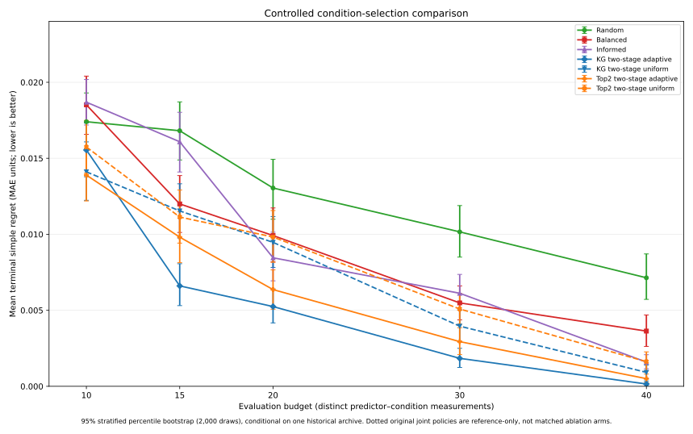
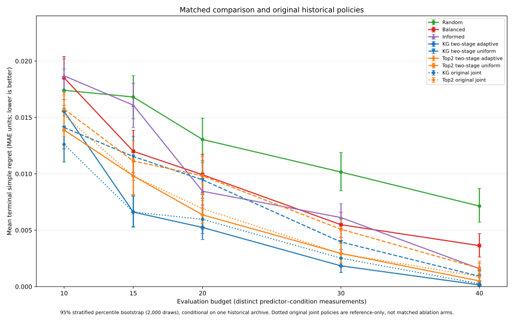

# Controlled condition selection in two-stage KG and Top2 — 6 November 2026

**Status:** Retrospective exploratory *within-archive* result on the frozen 7×12 matrix. This is a separately versioned two-stage study, **not** a change to the frozen original B1 v1 four-policy experiment or original one-step KG benchmark. Values and uncertainty intervals are taken from the executed, committed results, not newly recomputed in this document.

**Main figures:** [seven-policy matched comparison](results/controlled_condition_ablation_v1/b1_controlled_seven_policy_regret_vs_budget_ci_v1.svg) · [nine-policy comparison with historical joint-acquisition references](results/controlled_condition_ablation_v1/b1_nine_policy_with_historical_refs_ci_v1.svg).

**Numeric evidence:** [20-row summary](results/controlled_condition_ablation_v1/controlled_budget_summary.csv) · [per-budget and across-budget paired contrasts](results/controlled_condition_ablation_v1/controlled_paired_contrasts.csv) · [run manifest](results/controlled_condition_ablation_v1/controlled_manifest.json) · [plot manifest](results/controlled_condition_ablation_v1/plot_manifest.json) · [replay script](b1_condition_selection_controlled_v1.py) · [plotting script](plot_b1_condition_selection_controlled_v1.py).

## Scientific question and design

Does adaptive selection of the **condition** within a chosen predictor reduce finite-budget terminal decision regret relative to uniformly selecting one of that predictor's remaining conditions?

The full reference target remains the equally weighted mean over all twelve provider-world × graph conditions, and the terminal estimator remains the original additive Gaussian posterior mean. Each run evaluates exactly one distinct predictor–condition pair at each step, beginning from the shared seven-predictor observation on one starting condition.

For each of two newly defined *two-stage* families (KG and budget-aware Top2), the arm-selection function is **identical between its adaptive and uniform variants, conditional on current observed history**. The condition sampler changes:

- **KG family:** the arm is selected by the **mean** available one-step KG gain across that arm's unevaluated conditions. Adaptive then chooses that arm's condition with maximum one-step KG gain; uniform samples one unevaluated condition uniformly.
- **Top2 family:** preserve the fixed schedule of `ceil((B-7)/2)` coverage steps after initialization; choose a least-sampled arm during coverage, then choose among the two lowest-posterior-mean arms by **mean** available variance reduction. Adaptive conditions use provider–graph balanced coverage scores during the coverage phase and maximum variance reduction afterward; uniform conditions are sampled uniformly within the selected arm.

Both variants of a family have the **same algorithm**, given the same observed history, for choosing which predictor to evaluate. Different early observed conditions can nevertheless cause subsequent histories and arm selections to diverge. The estimand is therefore the **whole-policy effect** of changing condition selection in a sequential policy, *not* a direct effect under identical realized arm paths.

These two-stage arm selectors differ from the **original single-stage / joint-action** KG (maximize gain over all predictor–condition pairs) and historical Top2 (balanced over joint pairs in coverage, joint maximum in Top2 phase). Those historical curves are shown separately as references and are not controls for the two-stage condition-ablation contrast.

## Results

| Budget | KG adaptive | KG uniform | Top2 adaptive | Top2 uniform |
|---:|---:|---:|---:|---:|
| 10 | 0.015545 | 0.014109 | 0.013893 | 0.015741 |
| 15 | 0.006605 | 0.011537 | 0.009811 | 0.011136 |
| 20 | 0.005245 | 0.009470 | 0.006362 | 0.009822 |
| 30 | 0.001839 | 0.003957 | 0.002938 | 0.005085 |
| 40 | 0.000151 | 0.000917 | 0.000503 | 0.001621 |
| **Equal-budget mean** | **0.005877** | **0.007998** | **0.006701** | **0.008681** |

All values are mean terminal simple regret (MAE units; **lower is better**), computed from **240 seeded decision episodes per policy and budget** (12 initial cells × 20 repetitions). Across five budgets this corresponds to **4,800 episodes**, with **110,400 recorded individual evaluations** (the latter count is *not* independent replicates). Confidence intervals for each curve use **2,000 stratified percentile-bootstrap resamples** conditional on initial cell. The plots draw their limits directly from the archived summary files, not from a separate resampling procedure.

**Paired effects, uniform minus adaptive (positive favors adaptive):**

| Budget | KG difference | KG 95% interval | Top2 difference | Top2 95% interval |
|---:|---:|---:|---:|---:|
| 10 | −0.001436 | [−0.003847, 0.000851] | 0.001848 | [−0.000111, 0.003719] |
| 15 | 0.004931 | [0.002624, 0.007201] | 0.001325 | [−0.000937, 0.003549] |
| 20 | 0.004225 | [0.002397, 0.006171] | 0.003460 | [0.001431, 0.005529] |
| 30 | 0.002118 | [0.000936, 0.003263] | 0.002147 | [0.000868, 0.003345] |
| 40 | 0.000766 | [0.000302, 0.001280] | 0.001119 | [0.000486, 0.001806] |
| **Across-budget mean** | **0.002121** | **[0.001281, 0.002960]** | **0.001980** | **[0.001202, 0.002819]** |

The across-budget difference corresponds to relative reductions in mean regret of **approximately 26.5% for KG** and **22.8% for Top2** when using adaptive rather than uniform condition selection, calculated relative to the uniform variant. At budget 10, the observed KG direction reverses and its paired interval includes zero; Top2 intervals include zero at budgets 10 and 15. The intervals are not corrected for multiplicity and do not constitute independent-world evidence.

## Figures and comparison scope

*Figure A. Seven-policy view:* three preserved original B1 baselines (Random, Balanced, Informed) and the **four new matched two-stage policies**. The strongest support for the condition-selection contrast comes from **within-family adaptive vs uniform** comparisons and their paired bootstrap differences; comparisons across the different policy families are observational within this retrospective archive.

*Figure B. Nine-policy context:* the same seven curves plus **the historical single-stage KG and historical budget-aware joint-action Top2** as dotted reference curves. The historical policies are not members of the matched condition-choice ablation, and they are not renamed or replaced.

## Reproducibility and limits

The committed [run manifest](results/controlled_condition_ablation_v1/controlled_manifest.json) records the frozen matrix SHA-256 `0b58b7b6ff7489aec169a36c88a166fdb75b88e5089f14b1a610721581bb314d`, the replay source hash, 4,800 episodes, 110,400 action rows, and 2,000 bootstrap resamples. The committed [plot manifest](results/controlled_condition_ablation_v1/plot_manifest.json) records source hashes for the original B1 and KG summaries and the new controlled summary. Original four-policy and KG evidence has not been overwritten.

The **summary CSVs, figure SVGs and manifest files** are tracked in Git. Episode and action-history files are retained locally, with checksums in the run manifest, rather than committed to the repository. Accordingly, the Git archive verifies the provided summaries' provenance but does **not** by itself contain every underlying replay row needed for a complete independent episode-level audit.

This study is exploratory on **three historical provider worlds, four composition graphs and seven frozen algorithms**. Repetition estimates variation under randomized *allocation sequences*, not uncertainty across independently drawn physical worlds. The results do not establish broader best-arm identification optimality, novelty relative to KG/BAI literature, runtime savings, robustness to model misspecification or out-of-sample generalization.

**Conclusion:** In this frozen archive and these two-stage policy definitions, adaptive condition selection decreases average terminal simple regret relative to uniform condition selection for both KG and Top2. This supports including condition choice as a distinct experimental-design component in the PRAISE sequential validation study, with its effects qualified as retrospective and policy-specific.
