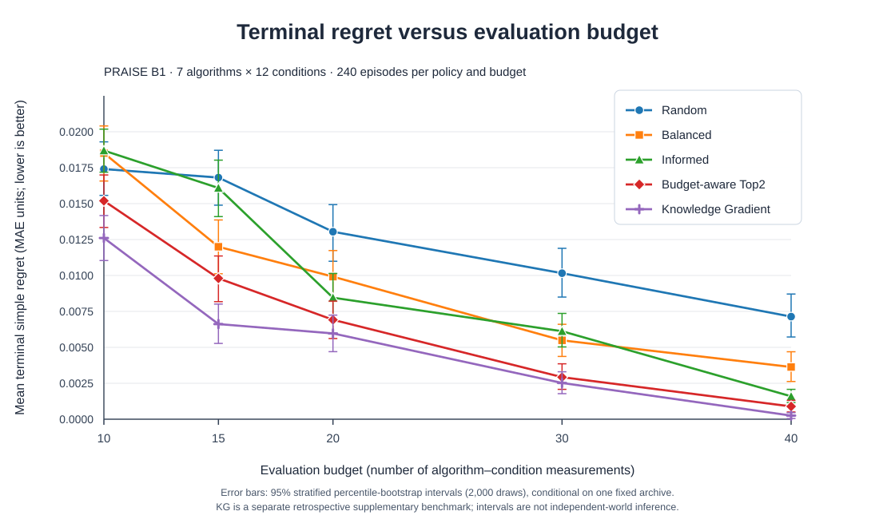

# B1 one-step Knowledge Gradient — supplementary development result (2026-11-05)

**Status:** completed, audited **retrospective on the original 84-action B1 archive**. This is **NOT** independent-provider-world confirmation, a formally prospective validation, an optimality result for horizons B=10..40, or evidence of a new acquisition algorithm. **The original four-policy B1 v1 experiment is unchanged.**

## 1. Freeze and theoretical target

**Spec frozen before seeing KG results:** [B1_KG_ONE_STEP_SPECIFICATION_V1.md](B1_KG_ONE_STEP_SPECIFICATION_V1.md) (commit \`e01ee54\`).  
**Executable KG policy committed before replay:** [b1_kg_one_step_v1.py](b1_kg_one_step_v1.py) (commit \`1075635\`), [synthetic tests](test_b1_kg_one_step_v1.py) (initial commit \`36a43d2\`; later NumPy-version portability edit only).  
**Foundational literature:** [Frazier, Powell & Dayanik, SIAM J. Control Optim. 47(5), 2008](https://doi.org/10.1137/070693424); [correlated normal KG, INFORMS J. Computing 21(4), 2009](https://doi.org/10.1287/ijoc.1080.0314).

**KG action:** choose one hitherto unevaluated (algorithm, cell) maximizing the **one-step** expected improvement in the lowest posterior mean of *whole-domain algorithm MAE*, evaluated analytically under B1's original independent-per-algorithm Gaussian surrogate. All 84 possible one-time evaluations are admissible until revealed. No KG policy tuning, no extra coverage schedule, no oracle of hidden MAEs. Original B1 prior, Gaussian likelihood, eight-dimensional design, terminal estimator and tie handling are imported unchanged. One-step KG does **not** solve the multi-step Bellman optimal-control problem for B=10..40.

**Exact equal opportunity:** seven original algorithms, twelve archived provider-world×graph cells, independent known budgets B=10,15,20,30,40, seven common initial evaluations, 12 starting cells ×20 seeded replicates **per budget**. KG adds **1,200 new episodes and 27,600 actions** without modifying any of the original **4,800 episodes**. Seeds use \`SeedSequence([20261105,B,start,rep,4])\`; each original policy used the same convention with indices 0..3. New KG summaries and paired contrasts use **2,000 within-archive, starting-cell-stratified bootstrap draws**, with \`seed=20262018\`, and match starting-cell/repetition indices with the archived original episode records. Different policy RNG streams are not common random action trajectories.

## 2. Exact result

**Lower regret is better.** Per-budget means use 240 KG episodes and 240 archived episodes per original policy. Correct selection means choosing the original 12-cell reference-best method, **M3_FULL343**.

| Budget | Random regret | Balanced regret | Informed regret | Top2 regret | **One-step KG regret** | **KG reference-best probability** |
|---:|---:|---:|---:|---:|---:|---:|
| 10 | 0.017404 | 0.018516 | 0.018690 | 0.015194 | **0.012607** | **51.7%** |
| 15 | 0.016812 | 0.011998 | 0.016087 | 0.009799 | **0.006620** | **67.9%** |
| 20 | 0.013044 | 0.009917 | 0.008455 | 0.006917 | **0.005968** | **70.8%** |
| 30 | 0.010159 | 0.005487 | 0.006120 | 0.002925 | **0.002522** | **83.8%** |
| 40 | 0.007138 | 0.003632 | 0.001592 | 0.000888 | **0.000251** | **97.9%** |
| **Equal-budget mean** | **0.012911** | **0.009910** | **0.010189** | **0.007145** | **0.005594** | |

The equal-budget KG mean is **0.00559351309** MAE regret, versus original Balanced **0.0099098** and Top2 **0.0071446**. KG yields **43.6% lower** five-budget mean regret than Balanced, and **21.7% lower** than Top2. **The original Top2−Balanced 27.9% result is not replaced or altered.**

### All five regret–budget curves with 95% bootstrap error bars

*Figure: regret–budget comparison of the frozen four-policy B1 development study plus the separately specified one-step KG benchmark.* Each curve has five points at evaluation budgets **10, 15, 20, 30 and 40**. Every mean uses **240 seeded decision episodes**; vertical error bars are that policy's **95% within-archive stratified percentile-bootstrap interval (2,000 draws)**. The 7×12 MAE matrix, terminal estimator and evaluated budgets are identical across policies. Error bars are **not** independent-world confidence intervals and **not** KG-versus-Top2 paired difference intervals. See the [25-row plotting data](figures/b1_five_policy_regret_with_bootstrap_ci_v1.csv).

KG has lower mean regret at every budget on this archive. The **paired** comparisons and their own intervals are shown next; visually overlapping marginal intervals alone must not be used to infer pairwise significance.

### KG versus the frozen Top2 heuristic (paired episode bootstrap)

| Budget | KG − Top2 mean regret | Nominal 95% bootstrap interval |
|---:|---:|---|
| 10 | −0.002588 | [−0.005075, +0.000014] |
| 15 | −0.003179 | [−0.005219, −0.000985] |
| 20 | −0.000949 | [−0.002733, +0.000749] |
| 30 | −0.000403 | [−0.001494, +0.000661] |
| 40 | −0.000637 | [−0.001107, −0.000201] |
| **Equal-budget aggregate** | **−0.00155108385** | **[−0.00231624924, −0.00079396346]** |

The **mean** KG regret is lower at all five budgets. The per-budget nominal intervals for **B=10,20,30 include zero**; therefore do not claim five individually established improvements. Per-budget intervals are **not multiplicity-adjusted**. The across-budget interval, although negative, is **retrospective and conditional on a previously inspected archive**; it is not a new confirmatory significance statement.

### KG versus all the original control policies (equal-budget means)

| Comparison (KG minus original policy) | Mean regret difference | Nominal 95% bootstrap interval |
|---|---:|---|
| KG − Random | −0.007317893 | [−0.008311260, −0.006354080] |
| KG − Balanced | −0.004316300 | [−0.005137496, −0.003507227] |
| KG − Informed | −0.004595321 | [−0.005437168, −0.003797641] |
| KG − Top2 | **−0.001551084** | **[−0.002316249, −0.000793963]** |

## 3. Evidence quality and independent reconciliation

- **Source invariants:** input matrix SHA-256 \`0b58b7b6ff7489aec169a36c88a166fdb75b88e5089f14b1a610721581bb314d\`; input 4,800-episode reference SHA-256 \`c219b700d55683899867051f3cf1f154cea54655853026c47fda814c887d9f12\`. Both accepted by strict run-time checks.
- **Synthetic preflight:** **8 tests PASS**, covering independent Gaussian numerical integration, conjugate posterior update identity, no-repeat, deterministic tie seeds, no use of hidden unobserved MAEs in first acquisition, all budgets, and fail-closed hash rejection. Tests used only synthetic matrices / posterior states.
- **Execution:** \`B1_KG_SUPPLEMENTARY_REPLAY_PASS\`, 1,200 terminal episodes and 27,600 action rows. The run was repeated from a local source with Git blob SHA \`69878a751afefd79f4e84521ac438af45f695c19\`, which **exactly matches the committed GitHub KG implementation**. Both runs generated identical hashes for all four KG result CSVs.
- **Independent read-only audit:** **PASS** on 1,200/1,200 episodes and 27,600/27,600 actions: each unique action matches the frozen 84-MAE matrix; the first seven actions are the same one-cell seven-algorithm warm start; no repeated actions; every terminal choice recomputes from B1's unchanged Gaussian posterior, and every regret equals the full 12-cell truth difference. All KG-vs-original policy mean contrasts were independently recomputed from their respective episode rows, and every emitted CSV matches the manifest's SHA-256.
- **Frozen-B1 dependency note:** the local source used for the verification and replay was the user's earlier uploaded \`b1_budget_comparison_v1.py\` (SHA-256 \`f87d148eba2285051fdfb51f610aef53149e39940d1e902378b22e55203ce9c2\`). The canonical GitHub source has Git blob SHA \`b433e7d01da10dcad3448eedeea544ba7cefb33c\`. Cross-checks of the **exact blocks KG calls** (constant/prior/data definitions, \`posterior\`, \`choose_tie\`, CSV/hash utilities) found matching code contents despite this broader source-byte difference. A local repository execution remains useful for end-to-end reproducibility in the user's original Python environment.
- **No independent-WB bootstrap was rerun for KG:** this study uses the same 84 frozen cell-MAE values as B1's primary replay. The previous WB robustness checks were conducted for the four original policies and **cannot automatically be transferred to the fifth KG policy**.

### Canonical KG output SHA-256 values

| File | SHA-256 |
|---|---|
| \`kg_terminal_episodes.csv\` | \`9ea5a33020e9e53185a1ea55a862d074aea19d38fdfa6c12beef7cbc2840d2c2\` |
| \`kg_action_history.csv\` | \`4132347db567a4c544b955a865d5941178efb8550ceb2303b7e92536dd6de127\` |
| \`kg_budget_summary.csv\` | \`38deebbc19fc371817b5e7a5f9d9e2457a773de217010fb1da7ffb4e83cb792f\` |
| \`kg_vs_frozen_b1_contrasts.csv\` | \`409c8a1ed648d36b3ce12e8aa35942126b3f7f59f80eb3a6bc89a482e674220c\` |

The \`kg_manifest.json\` also records exact input and local script SHA-256 values, acquisition policy ID=4, B1 seeds, bootstrap seed, frozen method reference-best, and these output hashes. Complete outputs exist outside the repository in an isolated result directory.

## 4. Scientific implication and scope

**Supported:** on the previously inspected B1 finite matrix, the standard, objective-aligned **one-step KG** acquisition rule, using the *same heuristic Gaussian posterior and common terminal estimator*, achieved lower mean terminal regret than Top2, Balanced, Random and Informed at every studied budget. It is evidence that a recognized value-of-information rule is a stronger **development comparator** for this task than the previously designed heuristic.

**Not supported:** global finite-budget optimality; independently sampled provider-world improvements; model-calibrated posterior uncertainty; actual computational-time savings; simultaneous robust inference across five budgets; post-selection statistical significance; or superiority to other mature BAI baselines (BayesGap, UGapE, TTTS, structured design, etc.).

**Most important research consequence:** the original scientific question is *preserved* (fixed-budget selection of the best PRAISE predictor), but a broad novelty claim for our custom coverage/Top2 acquisition rule is not supportable. A stronger research program could study **whether established optimal-learning methods can efficiently solve structured, nonrepeatable algorithm×condition selection**, with independent transfer validation and an explicit computational-cost model *if warranted*. Such a study would be separately designed. Do not alter the original experiment in response to these results.

## 5. Reproduction

In an updated local checkout of branch \`praise-identifiability-feasibility\`, keep \`~/praise/planb_b1_fixed_budget_v1\` strictly read-only and choose a **new** KG output directory:

\`\`\`bash
cd ~/praise/praise-cao-sim
git pull --ff-only origin praise-identifiability-feasibility

python -m unittest discover -s first_science/b1/planb_validation \
  -p 'test_b1_kg_one_step_v1.py' -v

python first_science/b1/planb_validation/b1_kg_one_step_v1.py \
  --mode inspect \
  --matrix ~/praise/planb_b1_fixed_budget_v1/seven_method_matrix.csv \
  --baseline-terminal ~/praise/planb_b1_fixed_budget_v1/terminal_episodes.csv \
  --out ~/praise/planb_b1_kg_v1

python first_science/b1/planb_validation/b1_kg_one_step_v1.py \
  --mode replay \
  --matrix ~/praise/planb_b1_fixed_budget_v1/seven_method_matrix.csv \
  --baseline-terminal ~/praise/planb_b1_fixed_budget_v1/terminal_episodes.csv \
  --out ~/praise/planb_b1_kg_v1
\`\`\`

The runner rejects unexpected input hashes and refuses to overwrite an existing KG output directory. **Do not rerun any original B1 policy or modify its outputs.**

**Conclusion:** KG's positive retrospective comparator result is now an audited supplement to, not a replacement for, the frozen four-policy B1 evidence.
