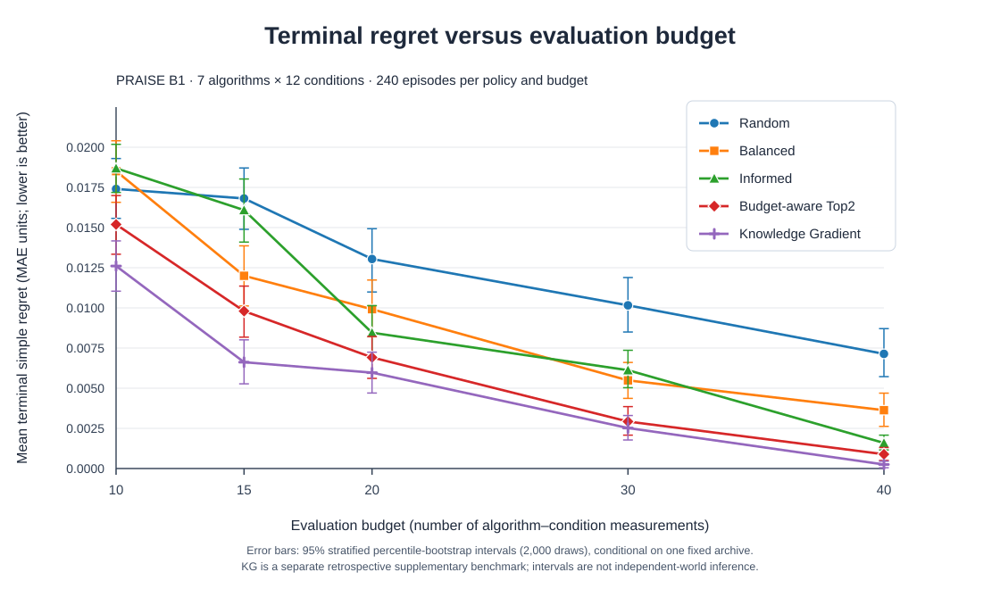

# B1 five-policy regret curves and 95% bootstrap error bars



**Scientific caption.** Mean terminal simple regret (MAE units, lower is better) against the total number of distinct algorithm×provider-world×graph evaluations. Each mean summarizes **240 seeded decision episodes** per budget/policy. Vertical error bars are **95% stratified percentile-bootstrap confidence intervals** obtained separately for each policy's mean from **2,000 resamples**. The four original B1 v1 curves are from the **frozen four-policy experiment**; the fifth curve (one-step Knowledge Gradient, KG) is from a **separately frozen and executed retrospective supplement**. All five policies use the same historical 7×12 algorithm×cell matrix and common Gaussian terminal decision rule. The intervals are conditional on one fixed historical archive, **not** uncertainty over independently sampled provider worlds. For between-policy comparisons, use the separately reported **paired** bootstrap difference intervals; overlapping/nonoverlapping marginal error bars alone are not paired inference.

## Provenance

| Frozen input file | SHA-256 |
|---|---|
| Original B1 `budget_summary.csv` (four policies, 20 rows) | `12a163b488266119f68391e96c8c63cebb4576516a312d3e48b5d4e77c657c80` |
| One-step KG `kg_budget_summary.csv` (five rows) | `38deebbc19fc371817b5e7a5f9d9e2457a773de217010fb1da7ffb4e83cb792f` |

The companion [25-row data table](b1_five_policy_regret_with_bootstrap_ci_v1.csv) reports each plotted `mean_regret`, `regret_low` and `regret_high` at exact numerical precision read from the two frozen source files. The checked-in vector figure [SVG](b1_five_policy_regret_vs_budget_ci_v1.svg) uses these values, not reconstructed error bars, smoothing or an additional bootstrap.

## Reproduce as PNG/SVG with Matplotlib, without new science

Run the [read-only plotting script](../plot_b1_regret_five_policies_v1.py) in an environment with `pandas`, `numpy` and `matplotlib`. Provide the original paths, not the full-precision 25-row intermediate table:

```bash
cd ~/praise/praise-cao-sim
python first_science/b1/planb_validation/plot_b1_regret_five_policies_v1.py \
  --original-summary ~/praise/planb_b1_fixed_budget_v1/budget_summary.csv \
  --kg-summary /path/to/your/kg_budget_summary.csv \
  --out ~/praise/planb_b1_five_policy_figures_v1
```

The source-input hashes and 25 unique policy/budget combinations must match. Outputs go to a new directory; the script refuses to overwrite existing results, **does not rerun any selection policy or bootstrap**, and writes a provenance manifest. Matplotlib rendering and the checked-in hand-optimized SVG may differ in typography and layout but plot **the same 25 means and interval limits**.

## Interpretation of the plotted result

- In this archived B1 matrix, KG has the lowest **observed mean terminal regret** at each of the five budgets. Its one-step value-of-information acquisition score is analytically derived under the frozen Gaussian surrogate; this does **not** establish optimality for a multi-action horizon.
- The original four-policy result (Top2 vs Balanced) remains frozen and unchanged; KG does not become an original B1 v1 policy retrospectively.
- The 25 error bars show **marginal episode-bootstrap intervals**. They do **not** certify five independent tests, independent provider-world performance or actual computational-hour savings.
