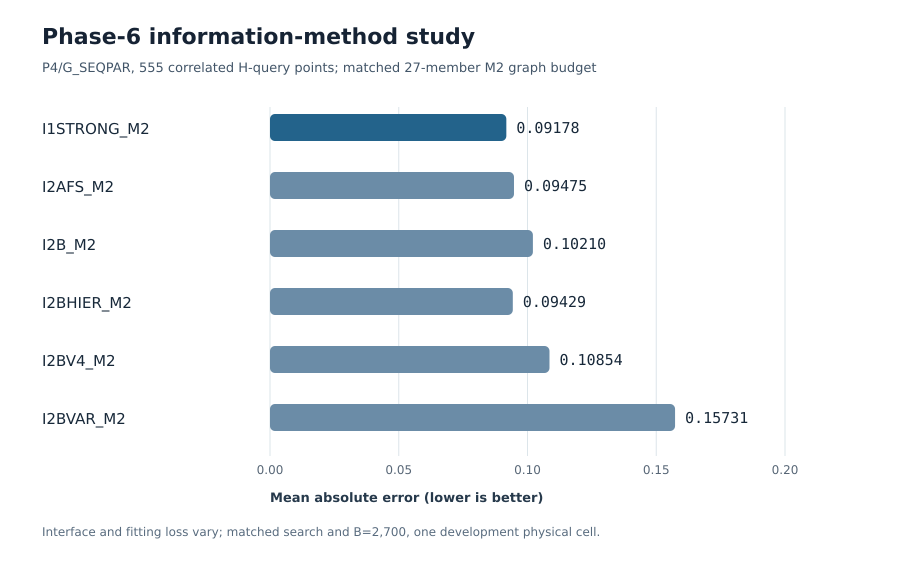

<!-- GitHub-optimized reading copy. The exact scientific source is B1_TECHNICAL_REPORT_DRAFT_V0_1.md; math is fenced for GitHub's math renderer. -->

# Executive synthesis 

In composed cloud-edge services, individual providers may advertise limited workload and SLA evidence while keeping their stochastic execution models private. The methodological challenge is to combine these separate disclosures into a prediction of end-to-end SLA satisfaction over a time horizon, without assuming access to hidden process parameters. We report the development, implementation, and evaluation of a family of methods indexed by provider information representation $I$ and integration procedure $M$, together with a simulator and a complete account of observed limitations.

We define the evaluated quantity as $\sigma_G(A,H;\rho)=\Pr[c_G(A,H)\ge\rho]$, where $c_G(A,H)$ is the fraction of **decided** composed requests that meet a specified latency-cost-quality region by time $H$. A missed latency deadline is a decided failure; requests not yet decided are excluded; zero decided requests yield compliance one. This quantity measures the probability that the composed service meets its SLA compliance target over the observation horizon $H$.

**Phase I (controlled pilot)** tested the original three-provider parallel graph. The original controlled pilot was promising. Against a fresh white-box reference ($N_{\mathrm{WB}}=200$: 200 new simulation runs using the true underlying model), across 555 related measurements (15 SLA conditions, each evaluated at 37 time horizons using shared simulation runs), the mean absolute errors (MAE) of a single reconstructed model (M1), a 27-member equal-weight ensemble (M2), and a Gibbs-weighted pilot M3 with 14 propagated joint models were respectively **0.18517, 0.06815 and 0.03037**. However, a retrospective cost-matched support audit found a Top1 estimator with MAE **0.02878**, slightly below the weighted Top14 estimator in that fixed pilot. The pilot therefore did not establish that multi-model averaging was necessary.

**Phase II (expanded battery)** evaluated generalization across multiple provider configurations and composition graphs. Sixteen evaluation cases were planned (four provider configurations combined with four composition graphs). The four cases involving configuration P2 did not meet the predefined criteria for informative SLA test conditions, so they were excluded without replacement. On the remaining 12 cells, with independent $N_{\mathrm{WB}}=1000$ final white-box trajectories per cell and 6,660 related measurements (555 per case) per fully applicable method, the executed Phase-5 V3b algorithms produced MAE **0.15702** (M1), **0.13395** (M2), and **0.12189** (M3 FULL343). M3 retained the best aggregate ranking, but hard conditions still had substantial errors. Its algorithm and candidate support also changed from the pilot and from the initially registered Phase-5 method. Accordingly these numbers cannot be treated as direct replications of the original 14-member method.

**Phase III (retrospective divergence tracing)** investigates that gap, including an original-style M3 comparison, without creating a new independent holdout. Reconstructing 48 public-I1-scored candidates/provider and propagating Top14 at B=1400 on the same 12 cells gave **MAE 0.15416** (separately simulated Top1, **0.16228**), versus **0.12189** for the executed V3b FULL343. Despite Top14 retaining at least **99.64%** of its inferred joint-model weight across P1, P3 and P4, FULL343 outperformed it in **11 of 12** cells. These post-result comparisons do not isolate member count or constitute a fresh holdout. A subsequent Phase III audit reproduced pilot estimator and native parallel-graph behavior on archived seeds while documenting candidate-domain drift and the transfer of the numerical Gibbs concentration instead of its original selection rule.

Subsequent development tests revealed further limitations. On P4/G_SEQPAR, stronger reconstruction from I1 alone performed comparably to, and on average slightly better than, several richer I2 information-and-loss pipelines under matched search and graph-propagation designs. This does **not** isolate the causal utility of information quantity because fitting objectives also changed. In a separate P2/G_PAR experiment using a deterministically composed public graph region, M1, M2 and M3 achieved MAE **0.13200, 0.14058 and 0.12787**, respectively, under **unmatched** graph budgets. A privileged retrospective audit then found that the true generating provider parameters fitted the public I1 evidence better than the selected reconstructed candidates despite lying inside the search domain. This is direct evidence of a search/reconstruction deficit, not a proof of structural non-identifiability.

The overall conclusion is conditional: end-to-end SLA estimation from limited disclosure is demonstrably feasible **in some controlled cases**, but the developed finite-search integration methods have not delivered reliable prediction across the studied variations. The technical report retains favorable, negative, and inconclusive evidence and distinguishes numerical Monte Carlo precision from uncertainty about the hidden system. In practical terms, this report provides the empirical foundation for a follow-up academic paper on how to design, validate, and report credible evidence for distributed management and optimization methods in hierarchical computing-continuum systems. The goal is to identify what must be controlled or tested before a promising pilot can support broader claims of robustness.

# 1. Research problem, scope, and prior context

## 1.1 Composable offerings and information boundaries

The computing continuum spans resources and services controlled by different administrative entities. An integrator may know its own workflow or service-composition graph while observing only restricted public claims about the providers on which it depends. Physical execution is shaped by stochastic service times, queues, branch synchronization, workload and cost accumulation. Predicting the performance of composed black-box services using only their providers' advertised performance measures is not equivalent to observing the resulting end-to-end behavior.

The Composable Autonomic Offering (CAO) abstraction represents an offering as

```math
o=(G,s,\sigma,r), \tag{1}
```

where $G$ is the composition graph, $s$ describes service objectives, $\sigma$ represents dependability or survival information, and $r$ is the realization envelope [12]. The CAO abstraction motivates predicting a useful dependability quantity, but does not, by itself, prescribe which information must be disclosed or which numerical method can produce a dependable composition estimate.

We separate these choices explicitly:

```math
\tau=(I,M), \tag{2}
```

with **information interface** $I$ and **integration method** $M$. The interface $I$ specifies what each provider discloses. Given these separate disclosures and the known composition graph $G$, the integrator applies $M$ to estimate the composed service's end-to-end SLA probability, $\widehat\sigma_G(A,H;\rho)$. Depending on the method, this may involve reconstructing provider models and propagating their predictions through $G$. Distinct $M$ may use the same $I$; conversely an information-rich interface can require a different reconstruction objective, making the evaluated unit an **information–method pair**.

The question is not whether analytical or stochastic QoS composition exists. It does [3,8,17–19]. Rather, the specific problem is **inverse, public-evidence-constrained** composition: can an integrator combine the probability surfaces advertised by individual black-box providers to estimate the composed service's finite-horizon, end-to-end SLA probability, without access to their execution traces or true parameters?

## 1.2 Research questions and evidence categories

The program addresses four related questions:

**RQ1, feasibility and limits.** When can finite public provider disclosures support useful graph-level SLA-satisfaction prediction, and in which worlds, topologies, regimes, or query regions does prediction fail?

**RQ2, methods under a fixed interface.** How do analytical propagation, a single provider reconstruction, equal-weight reconstruction portfolios and evidence-weighted finite supports compare? Which observed differences are due to candidate search, support membership, weights or numerical allocation, and which cannot be causally separated?

**RQ3, disclosure.** Does enriching the public interface with marginal or paired temporal compliance information improve the resulting *information–loss–integration pipeline* under matched reconstruction resources?

**RQ4, provenance and decision meaning.** How reproducible are the finite results, and what do numerical Monte Carlo intervals, model spread, reference error and support-truncation guarantees actually mean for an SLA threshold?

We organize the evidence into **three overarching phases: Phase I (controlled pilot), Phase II (expanded battery), and Phase III (retrospective divergence tracing)**. Phase I covers the frozen same-setting pilot; Phase II the registered expanded battery, documented pre-reference method revisions and held-out final evaluation; Phase III the retrospective divergence audit and related post-result exploratory analyses. These remain different evidence categories within the three phases. In Phase II, the final graph predictions were recorded before the final white-box results were examined, although the methods had already been revised during development. Phase III examines earlier results retrospectively and does not provide a new independent validation of those methods.

## 1.3 Scientific boundaries

This document does not establish a structural identifiability theorem. Multiple candidate models with different parameters and similar *finite empirical* I1 errors may reflect a non-injective information map, measurement noise, search limitations, model family restrictions, or some combination. The present observations cannot distinguish these causes in full generality.

# 2. Formal SLA objective and benchmark semantics

## 2.1 Request-level admissibility

For a composed request, denote latency, accumulated cost and quality by $(L_G,C_G,Q_G)$. A rectangular admissibility region is

```math
A=\{(L,C,Q): L\le\ell,\ C\le c,\ Q\ge q\}.
```

A request is **compliant** when it is decided and its final outcome lies in $A$. The simulator records the top-level emission and, if available before simulation stop, the completion time. An on-time request is decided at completion. An uncompleted or late request is decided as a latency failure when its deadline arrives. A request whose completion and deadline are still in the future is unresolved at the current evaluation horizon. The SLA-scoring rule does not equate “unresolved” with “failed”.

Let $\mathcal D_G(H)$ be the set of top-level requests *decided* by horizon $H$, and $\mathcal C_G(A,H)\subseteq\mathcal D_G(H)$ the compliant subset. Define, with the explicitly frozen zero-decision convention,

```math
c_G(A,H)=
\begin{cases}
1, &|\mathcal D_G(H)|=0,\\[2mm]
|\mathcal C_G(A,H)|/|\mathcal D_G(H)|, &|\mathcal D_G(H)|>0.
\end{cases}
\tag{3}
```

For required compliance fraction $\rho\in[0,1]$, the true graph-level estimand is

```math
\boxed{\sigma_G(A,H;\rho)=\Pr\{c_G(A,H)\ge\rho\}.}
\tag{4}
```

The probability is taken over independent stochastic trajectories of the specified provider world, workload and execution graph. The horizon $H$ determines which decided requests are included in the compliance fraction. As more requests are decided, this fraction may rise or fall, so $\sigma_G(A,H;\rho)$ is **not guaranteed to decrease with $H$**. We therefore use the precise term “horizon-dependent SLA-satisfaction probability” throughout the report.

The numerical methods compute $\widehat\sigma_G^{(I,M)}(A,H;\rho)$, and the hidden world is only evaluated through a separate finite white-box reference $\widehat\sigma_G^{\mathrm{WB}}$ under experimental conditions that permit it.

## 2.2 Prediction target and evaluation reference

**What do we estimate?** For a known composition graph $G$ and an SLA query $(A,H;\rho)$, Equation (4) defines $\sigma_G(A,H;\rho)$, the probability that the composed service meets the required compliance fraction. The integrator does not know the providers' hidden stochastic execution models. It has only the information each provider discloses through interface $I$. Integration method $M$ uses those disclosures and the known graph to produce the end-to-end prediction $\widehat\sigma_G^{(I,M)}(A,H;\rho)$. **The scientific task is to assess the accuracy and limits of this probability prediction.**

**How do we evaluate it?** In the simulator, the true provider models can be used to generate an independent finite white-box reference $\widehat\sigma_G^{\mathrm{WB}}(A,H;\rho)$. We compare each method's prediction with this reference across the tested SLA queries, horizons, provider worlds and graph topologies. The hidden provider models used for final reference generation are not supplied to the methods being evaluated. Because the reference is computed from a finite number of stochastic runs, it is itself an estimate of $\sigma_G$, not an exact value. Numerical simulation error and reconstruction error must therefore be distinguished (Chapter 10 and Appendix A).

# 3. Provider disclosures

## 3.1 Public interface I1

Under the original public interface I1, each provider advertises a finite family of rectangular admissibility regions indexed by a target content level $\rho_r$:

```math
A_i(\rho_r)=
\{L_i\le\ell_i(\rho_r),\, C_i\le c_i(\rho_r),\, Q_i\ge q_i\}.
\tag{5}
```

Here $L_i$, $C_i$ and $Q_i$ are the provider's latency, cost and quality outcomes. The functions $\ell_i(\rho_r)$ and $c_i(\rho_r)$ specify **numerical latency and cost limits** for each advertised index $\rho_r$. They are finite lookup mappings, not time-varying performance functions. In this simulated experiment, the framework prepares a separate I1 card on behalf of each provider and makes it available to the integrator. To construct its advertised regions, the provider-side procedure fits a joint model of private latency and cost observations (a Gaussian mixture in log latency and log cost). It draws a fixed synthetic sample from that model and, for each $\rho_r$, chooses a minimum-area rectangle containing at least that fraction of sampled outcomes, while retaining the preceding region. Consequently the regions are **nested**: when $\rho_r<\rho_r'$, $A_i(\rho_r)\subseteq A_i(\rho_r')$, so neither the latency nor the cost limit decreases. In the studied provider worlds, the quality outcome is constant at $Q_i=0.5$, with advertised limit $q_i=0.5$. Thus quality is not a varied experimental dimension, and the regions differ only in their latency and cost limits.

The index $\rho_r$ thus specifies the **target content of the fitted latency-cost model**, not a guaranteed fraction of compliant requests during an execution horizon. The latter is the separate SLA-compliance threshold $\rho_q$. Once the regions are fixed, each provider advertises an empirical probability surface

```math
\widehat\sigma_i^{I1}(A_i(\rho_r),H;\rho_q)
\approx \Pr\{c_i(A_i(\rho_r),H)\ge\rho_q\}.
\tag{6}
```

The historical pilot used $\rho_r,\rho_q\in\{0.95,0.975,0.98333,0.99,0.995\}$ and a 5-second horizon grid up to 240 seconds, with a workload period of 0.2 seconds. Provider-card acquisition used two disjoint banks of 100 complete simulation trajectories each. The first bank (seeds 6000--6099) was used only to fit the provider's latency-cost model and construct the regions. The second bank (seeds 6100--6199) evaluated the already fixed regions. For each $(A_i(\rho_r),H,\rho_q)$, each trajectory in the second bank contributed one binary outcome: whether its decided-request compliance fraction reached $\rho_q$ by horizon $H$. Thus $\widehat\sigma_i^{I1}=n_{\mathrm{pass}}/100$ is the fraction of successful trajectories, **not** an average of raw traces, the mean of per-trajectory compliance fractions, or the fraction of compliant requests pooled across trajectories. The same trajectories are reused across regions, horizons and compliance thresholds, so the points on the probability surface are correlated. Each simulation run also supplies provider-local ledgers for all three providers.

The public I1 card includes pointwise 95\% Wilson binomial confidence intervals for each estimated SLA-satisfaction probability (the chance that a new independent provider trajectory achieves at least the required fraction $\rho_q$ of compliant decided requests for region $A_i(\rho_r)$ by horizon $H$). These intervals are disclosed as part of I1, but none of the evaluated methods M0, M1, M2 or M3 uses them. The card does **not** disclose request timestamps, hidden queue/service trajectories or provider parameters.

The provider-side procedure uses private simulation evidence to construct the finite I1 card. The integrator, by design, sees only that card. This provider-versus-integrator information boundary is essential: giving a method the hidden sample identities, generating parameters or white-box graph predictions would change $I$ and invalidate the intended inverse reconstruction comparison.

Note that I1 discloses provider-level regions $A_i$, not the graph-level SLA query region $A_G$ for the composed service. For each experimental comparison, $A_G$ is fixed and shared by the methods being evaluated.

## 3.2 Enriched I2 interfaces

The post-result I1/I2 experiments were developed in the repository's `first_science/phase6/` folder (historical Phase-6) and belong to global Phase III in this report. They retain the I1 provider regions and horizon grid and reuse the corresponding provider-local simulation evidence. What changes is the information disclosed to the integrator about how often, and how consistently, each provider satisfies its advertised regions.

**I2a: distribution of compliance across simulation runs.** Fix one advertised provider region and one evaluation horizon. In each independent simulation run, the provider handles many requests. We calculate the percentage of requests decided by that horizon that satisfy the region's latency, cost and quality limits. This gives **one compliance percentage per run**. To illustrate, suppose four runs produce 98%, 96%, 94% and 70% compliance. If the SLA requires at least 95%, two runs satisfy it and two do not. For this threshold, I1 would report only the pass rate, 2 out of 4 runs (50%). I2a would instead disclose the four compliance percentages themselves, sorted as 70%, 94%, 96% and 98%. The integrator can therefore see not only how often the SLA is met, but also how much compliance varies and how severely it can fall below the requirement. In the actual experiment, **100 independent runs**, rather than four, provide 100 compliance percentages for each advertised region and horizon. These percentages are sorted separately for every horizon, so I2a does not reveal which values at different horizons came from the same run.

**I2b: paired compliance at two horizons.** I2b includes the I2a distributions and adds pairs of compliance fractions measured in the *same* trajectory at two selected horizons. A pair such as (0.98, 0.91) means that cumulative compliance in one run declined from 98% to 91% between those horizons; the fractions still refer to all requests decided since the start, not just requests processed within the interval. For each selected interval, the published representation contains 100 such pairs. The frozen design samples intervals starting at 5 seconds and then every 10 seconds, with separations of 20, 30, 40, 50, 75, 100, 150 or 200 seconds where both endpoints fit within the 240-second horizon. The pairs reveal whether good or poor compliance tends to persist or change over time. They contain no trajectory identifiers, and the published records cannot be linked across different intervals by a shared identifier; they are not complete request histories or labelled trajectories.

**Additional disclosure in I2b-v4.** The later I2b-v4 extension publishes one more value for each selected interval: the average, across the 100 runs, of the difference between the highest and lowest cumulative compliance fractions recorded during that interval on the 5-second evaluation grid. This describes variation *inside* an interval that its two endpoint values alone cannot reveal. Individual runs' ranges and complete histories remain private. Section 4.3 explains how M2 uses I1, I2a, I2b and this additional summary to reconstruct provider models. The results appear in Section 9.3.

# 4. Integration algorithms and historical method versions

## 4.1 M0: analytical public-boundary predictor

M0 starts with a worst-case question: **If every provider meets its advertised limits for a request, what limits can we guarantee for the complete service?** The provider's advertised region $A_i(\rho_r)$ (Eq. (5)) gives a maximum latency $\ell_i$, a maximum cost $c_i$ and a minimum quality $q_i$. We combine these limits, rather than assuming that providers always satisfy them.

The rules follow from how the services execute. In a sequence, one service starts after the preceding one finishes, so the maximum total latency is the sum of the individual maximum latencies. In a parallel composition whose branches start together and must all finish, the maximum latency is that of the slowest branch. Cost is added in both cases because every required service incurs cost. For quality, the model explicitly defines the composed value as the lowest quality among the required services; this is a modeling rule, not a universal law. Before including processing and communication overhead, we obtain

$
\begin{aligned}
\operatorname{Seq}:&\quad
\ell=\sum_i\ell_i,\quad c=\sum_i c_i,\quad q=\min_i q_i,\\
\operatorname{ParAll}:&\quad
\ell=\max_i\ell_i,\quad c=\sum_i c_i,\quad q=\min_i q_i.
\end{aligned}
\tag{7}
$

Equation (7) applies only to requests for which all required providers respect their advertised limits. If any provider exceeds its limits, these combined limits may no longer hold. The equations do not tell us how often the providers meet those limits or how likely the composed service is to meet its SLA.

For a graph made of sequences and all-required parallel joins, M0 applies the same rules recursively. For example, in $G=A\to(B\parallel C)$, the provider-only limits are $\ell_G=\ell_A+\max(\ell_B,\ell_C)$, $c_G=c_A+c_B+c_C$ and $q_G=\min(q_A,q_B,q_C)$. The actual execution graph can also contain fixed processing stages, network hops and join-control messages. Their latency and cost contributions must be included at the positions where they occur in the graph, before applying the sums and maxima. Different branch overheads, for example, belong inside the parallel maximum.

The original Phase-I pilot provides one concrete instance. Its execution path is Source $\to$ Fpre $\to$ $(A\parallel B\parallel C)$ $\to$ Fpost. The frozen configuration contributes three network-data hops of $0.001001$ s each (into Fpre, out to a provider branch, and onward to Fpost), a zero-byte provider-to-controller completion message taking $0.001$ s, and two fixed processing stages of $0.005$ s each. The fixed latency is therefore $3(0.001001)+0.001+2(0.005)=0.014003$ s. Fpre and Fpost each add $0.015$ cost units, while those network hops carry no cost, giving $0.015+0.015=0.03$. For this pilot, the composed limits are $\ell_G^{M0}=0.014003+\max_i\ell_i$, $c_G^{M0}=0.03+\sum_i c_i$ and $q_G^{M0}=\min_i q_i$. These terms are calculated from the frozen simulator configuration, **not measured from white-box SLA outcomes**. Another graph requires its own accounting of processing, communication and synchronization; the pilot constants cannot simply be reused.

Two different graph-level regions enter this comparison. The region $A_G^{I1}$ is obtained by combining the advertised provider limits with the graph's fixed overheads, as described above. The region $A_G$ is the SLA requested for the complete service. They need not be equal. For example, $A_G^{I1}$ may allow at most $80$ ms latency and $8$ cost units, while the requested $A_G$ allows $100$ ms and $10$ units, with the same minimum quality. The white-box reference tests complete-service requests against the requested $A_G$. M0 instead uses the I1 probabilities for the provider regions that generated $A_G^{I1}$.

M0 can make a prediction only if the calculated latency and cost limits do not exceed those requested, and the calculated minimum quality meets the requested minimum. Equivalently, $A_G^{I1}\subseteq A_G$. For example, if the SLA permits at most $100$ ms but M0 calculates a limit of $120$ ms, M0 reports **not applicable** for that query. This does not mean the actual service will fail; the advertised limits are simply insufficient for this M0 prediction. When the limits pass the check and the required I1 card values are available, M0 multiplies the provider probabilities at the same $\rho$:

```math
\widehat\sigma_G^{M0}(A_G,H;\rho)
=\prod_{i\in\{A,B,C\}}
\widehat\sigma_i^{I1}(A_i(\rho),H;\rho).
\tag{8}
```

Although the result is written as a prediction for the requested $A_G$, the product in Eq. (8) does not use the limits of $A_G$ directly. For fixed provider cards, $H$ and $\rho$, M0 therefore returns the same probability for any requested region that contains $A_G^{I1}$. The white-box reference $\widehat\sigma_G^{\mathrm{WB}}(A_G,H;\rho)$ instead scores each simulated execution against that specific requested region. Moreover, M0's product need not equal the white-box probability even at $A_G^{I1}$, because providers may miss their limits on different requests. Thus the comparison uses the same requested SLA, but M0 and WB assess it differently.

Equation (8) predicts how often a complete execution will meet the graph-level SLA. Suppose the SLA requires at least 95% of requests decided by time $H$ to comply. If M0 predicts $0.80$, it means that about 80 out of 100 independent executions are expected to achieve that 95% target. It does not mean that 80% of individual requests will comply. This is an estimate, and the actual probability may be higher or lower. The reason is that providers may fail on different requests. For example, in one run of 100 requests, providers A and B could each meet their own limits on 95 requests, but on different sets of requests; then only 90 requests meet both providers' limits. Thus meeting the same compliance threshold at each provider does not ensure that the composed service meets it. Queues and branch synchronization can further affect end-to-end performance. Because M0 does not provide a prediction for every SLA query, its mean absolute error (MAE) should be compared with M1/M2/M3 only on the queries for which M0 provides a prediction.

## 4.2 M1: one reconstructed provider process per provider

M1–M3 reconstruct stochastic provider-process candidates from the disclosed evidence. The assumed process family for each provider is parameterized by

$
\theta_i=(\mu_i,\kappa_i,\mathrm{CV}_i),
\tag{9}
$

where $\mu_i$ is mean service time, $\kappa_i$ is cost rate and $\mathrm{CV}_i$ is the coefficient of variation of service time. The actual generating parameters are hidden from the integrator; fitted candidates need not recover the physical truth.

M1 fits one stochastic surrogate to each provider's public evidence, combines the three selected provider models and simulates the native graph. The original Phase-3/4 method used a larger single TPE search with its own confirm/replay process and selected one provider hypothesis each. The executed Phase-5 V3b version instead started from **seven independent 25-trial TPE searches per provider**, with separate local search seeds. It rescored the seven run winners on a fresh common $N=100$ local evidence bank and selected the minimum I1 RMSE candidate. A second independent local bank was diagnostic and not used to choose the model.

A reconstructed parameter vector is a **candidate fitted to I1**, not a recovered physical truth. Later privileged P2 tests found lower I1 errors at the actual generating parameters than at the selected candidates.

## 4.3 M2: equal-weight finite model propagation

Given three candidate provider models for each provider, M2 propagates the $3^3=27$ Cartesian joint models. Its point estimate is

```math
\widehat\sigma_G^{M2}
=\frac{1}{27}\sum_{j=1}^{27}\widehat\sigma_G(A,H;\rho\mid\vartheta_j).
\tag{10}
```

The historical **Phase-4 M2** selected deliberately diverse I1-compatible representatives and **excluded the M1 anchor** from its portfolio by contract. The executed **Phase-5 V3b M2** chose ranks 1–3 by common-bank I1 RMSE among seven candidates per provider, so the M1 rank-1 provider model **is included** in each V3b M2 local portfolio. There was no hard I1-compatible threshold in the V3b ranking. M2's reported 27 models are thus not a fixed scientific intervention across phases.

The main Phase-5 graph budget for M2 was 100 trajectories per joint model, **2,700 trajectories per physical cell**. Shared seed indices were used across M2 member graph simulations, so a paired seed-index bootstrap is the appropriate numerical dependence-aware design.

**Phase-6 M2 reconstruction variants.** The six evaluated variants retain the 27 equally weighted joint models of Eq. (10), the same provider-model family and parameter domains, and matched reconstruction and graph-simulation budgets. Each provider search evaluates 256 candidate parameter settings (64 initial space-filling proposals, then 192 adaptive proposals). Each candidate is initially scored using 25 provider simulation runs; the best 24 are rescored with a separate common bank of 100 runs, and the best three per provider are retained. Each of the resulting 27 joint models is simulated 100 times in the graph, for 2,700 graph runs per variant. Search settings and random-number banks are matched, although adaptive proposals can differ when the fitting scores differ. The variants differ in **which disclosed evidence they use and how they select candidate provider models**:

| M2 variant | Public evidence and model-fitting criterion |
|:--|:--|
| I1STRONG_M2 | Uses the I1 probability surfaces. It selects candidate models that best reproduce the published probabilities of meeting each specified compliance threshold, across regions and horizons. |
| I2AFS_M2 | Uses the I2a distributions of per-run compliance. It selects candidates by comparing their predicted and disclosed distributions across all possible compliance thresholds, rather than only I1's five thresholds. |
| I2B_M2 | Uses the I2b pairs of compliance fractions at two horizons in the same run. It scores how closely the simulated *distribution of pairs* matches the published one, giving equal overall weight to each of the eight time separations and equal weight to windows within each separation. |
| I2BVAR_M2 | Uses the same I2b pairs and pair-matching score, but weights each window by the average squared change in compliance between its endpoints. The weights are normalized over all windows, so regions and time separations can receive different overall importance. |
| I2BHIER_M2 | Uses the same I2b pairs and pair-matching score. It preserves equal total weight for each of the five regions and eight time separations, while giving more weight to starting horizons with larger endpoint changes within each region and separation. |
| I2BV4_M2 | Uses the I2b endpoint pairs plus the new public mean within-interval range from Section 3.2. The range determines the weights of endpoint-pair matching within each region and separation; candidate models are not directly scored against the additional range statistic. |

Thus **I2a and I2b specify what providers disclose**, while these six M2 variants specify how a method fits provider models using that information. I2BVAR_M2 and I2BHIER_M2 change only the fitting weights applied to the same I2b pair data. I2BV4_M2 also uses an additional disclosed statistic. Comparisons across interfaces therefore test implemented disclosure-and-fitting combinations, not the isolated benefit of more information. All these Phase-6 tests are post-result development evidence; Section 9.3 reports their outcomes.

## 4.4 M3: public-evidence-weighted finite reconstruction

M3 forms a provider-model candidate bank and scores its members only against public information. In the evaluated family, finite provider weights take the form

```math
w_{i,k}
=\frac{\exp[-\lambda E_{i,k}]}
{\sum_{k'}\exp[-\lambda E_{i,k'}]},
\tag{11}
```

where $E_{i,k}$ is a public-I1 loss (for the executed version, a Jeffreys-smoothed Bernoulli KL discrepancy) and the temperature parameter $\lambda$ was selected from public-evidence development procedures. A joint model $\vartheta_j=(\theta_{A,a},\theta_{B,b},\theta_{C,c})$ receives product weight

```math
W_{a,b,c}=w_{A,a}w_{B,b}w_{C,c}.
\tag{12}
```

This is a weight over *hypotheses about providers*. The product does not remove the actual queueing/dependency interactions once a joint triple is propagated through the native simulator; those interactions remain inside each stochastic graph run. These Gibbs weights are **not calibrated posterior probabilities** of the hidden generating model.

For a selected set $S$, normalized aggregate weights $\alpha_j=W_j/\sum_{k\in S}W_k$ yield

```math
\widehat\sigma_G^{M3}
=\sum_{j\in S}\alpha_j
\widehat\sigma_G(A,H;\rho\mid\vartheta_j).
\tag{13}
```

The **historical pilot M3-v4** began with **48 candidates per provider**, used public-I1 Gibbs weights with $\lambda=30$, and propagated the **Top14** joint hypotheses under total graph budgets $B=1400$ or $2000$. Within this *finite* inferred distribution, those 14 members carried approximately 99.917% of the joint weight.

The executed **Phase-5 V3b M3 FULL343** instead used **seven independently obtained candidates per provider** and propagated **all $7^3=343$ joint hypotheses** with total budget $B=1400$. This replaced the registered Top14 execution after a **pre-graph-white-box** mass diagnostic found Top14 retained mass only 0.552 in P1, 0.962 in P3, and 0.867 in P4. It preserved the candidate bank and frozen weights, assigned at least one graph trajectory per joint member and greedily allocated the remaining budget using the reduction in the upper variance objective. The change was documented before the end-to-end graph reference was read, but it was still a **method revision**, not a confirmatory unchanged test of originally registered Top14.

For weights $W_j$ and independent Bernoulli member trajectories,

```math
\mathrm{Var}_{MC}(\widehat\sigma_G^{M3})
\le\frac14\sum_j\frac{W_j^2}{N_j},
\qquad \sum_jN_j=B.
\tag{14}
```

The continuous relaxation gives $N_j\propto W_j$; the finite algorithm initializes one trajectory/member and iteratively chooses the largest $\Delta_j=W_j^2/[N_j(N_j+1)]$, with a frozen rank tie-break rule. Archive verification reconstructed the P1/P3/P4 allocations **exactly**.

Crucially, **M3 Top1 is not definitionally M1**. M1 selects per-provider candidates by minimum common-bank I1 RMSE. M3 Top1 takes the maximum *product* of provider Gibbs weights based on KL energies; the two may select the same parameter tuple in some worlds, but identity is not guaranteed.

## 4.5 Within-ensemble support bounds

For any finite normalized Gibbs support, let $S$ retain weight mass $m_S\in(0,1]$, and let $p_{\rm full}$ and $p_S$ be respectively the expected SLA probability under the full finite distribution and the normalized retained submixture. Since each member probability is in $[0,1]$,

```math
\boxed{|p_{\rm full}-p_S|\le1-m_S.}
\tag{15}
```

The proof writes $p_{\rm full}=m_Sp_S+(1-m_S)p_{\rm omitted}$ and uses both probabilities in $[0,1]$. This is an **exact within-bank truncation bound**. For the pilot Top14, $1-m_S$ was approximately $0.000826$; for Phase-5 FULL343 it is zero **relative to the chosen 343-member bank**. Neither statement bounds error with respect to hidden graph truth.

### Method-version matrix

Historical Phase-4, Phase-5 and Phase-6 names identify repository experiment stages, **not** further overarching research phases. They belong respectively to global Phases I, II and III.

| Period | M1 selection | M2 membership | M3 support | Main M3 graph budget | Evidence role |
|:--|:--|:--|:--|--:|:--|
| Phase-4 pilot | Historical TPE single fit/provider | 3 diverse/provider; M1 anchor excluded | 48/provider $\to$ weighted Top14 | 1,400 or 2,000 | Same-world frozen pilot |
| Phase-5 registered V2 | Frozen TPE/domain policies | Separate diversity/compatibility policy | Originally Top14 | Planned 1,400 | Protocol, not final executed version |
| Phase-5 executed V3b | Best common-$N100$ RMSE of seven | RMSE ranks 1–3; includes M1 anchor | All 7/provider $\to$ FULL343 | 1,400 | 12-cell final-WB evaluation |
| October retrospective M3 | V3b remains comparator | Not re-estimated | 48/provider Top14 and Top1 | 1,400 each | Post-result same-WB comparison |
| Phase-6 matched | Strong I1 or I2-specific loss and 256-trial search | Top3/provider, 27 equal weights | **Not evaluated** | Not applicable | Post-Phase5 development |

The matrix deliberately does **not** imply identical candidate search, local costs, physical-cell populations or empirical credibility across the rows.

# 5. Native simulator, graph structures, and experiment protocol

## 5.1 Modified YAFS/AICon composition engine

The discrete-event environment uses YAFS as extended under AICon [9,11]. Modified YAFS application/core code registers compositions and per-branch dependencies, carries a per-request **composition path**, activates a dependent branch when its required sibling completions for that invocation have been received, and emits a single all-required composition output. Standalone code probes cover elementary joins, scoped dependency isolation and nested compositions.

The Phase-5 scientific test does **not** exercise arbitrary nested service DAGs. It compiles a small family of exactly three-provider sequence/parallel ASTs into dependencies in **one** native composition controller. Source/Fpre/provider/Fpost execution uses fixed physical node embedding and placement across all four logical graphs. Periodic arrivals are sent to stochastic provider services, with native queueing, service cost and network delays.

The four frozen dependency maps are:

| Logical graph | A predecessors | B predecessors | C predecessors | Reading |
|:--|:--|:--|:--|:--|
| G_PAR | none | none | none | $A\parallel B\parallel C$ |
| G_SEQ | none | A | B | $A\to B\to C$ |
| G_SEQPAR | none | A | A | $A\to(B\parallel C)$ |
| G_PARSEQ | none | none | B | $A\parallel(B\to C)$ |

**These are four logical composition structures, not four separately changed physical infrastructure topologies.** The companion source-level audit documents the Graph AST compiler, validation of unique leaves, deterministic replay probes and controller source locations.

The inspected runtime constructs an empty acting management-agent network. It therefore evaluates *offline graph performance estimation*, not online active-inference orchestration, decentralized planning or adaptive placement. WATT is zero in these test topologies and messages use a neutral QoS propagation specification; although $(L,C,Q)$ is the formal admissibility schema, strong empirical energy/quality variation was not established by the core battery. These are limits on external validity, not omissions to conceal.

## 5.2 White-box worlds, public evidence, and test set design

The research stages intentionally distinguish **disclosure production**, **query design**, **reconstruction**, **blind prediction**, **final white-box reference** and **evaluation**. The ability to inspect generating provider parameters belongs to privileged experiment construction and later retrospective diagnostics, not to the permitted reconstruction method.

The Phase-5 registered experiment included four provider worlds P1–P4, the four graph forms above and a five-$\rho$ by three-regime query battery in each planned world-by-graph cell. Step-0 used dedicated calibration and confirmation white-box evidence to freeze nondegenerate regional difficulty and determine eligibility. This evidence was allowed for **experiment design only**; it was not the final embargoed graph reference. Four P2 cells failed the registered Step-0 gate. They were recorded as missing/failed design conditions and **not repaired, silently replaced or included** in the 12-cell evaluation.

The main evaluation used horizons $H=60,65,\ldots,240$ seconds, **37 per query**, 15 query conditions per eligible physical cell, or **555 related SLA measurements per cell**. With 12 eligible cells, this yields 6,660 points per fully applicable M1/M2/M3 method. Each cell's separate final graph white-box reference used 1,000 trajectories, held back until global prediction freezing.

## 5.3 Execution chronology and integrity controls

The registered research pipeline was intended to flow from engineering smoke through I1 publication, Step-0 eligibility, reconstruction, blind graph prediction, global freeze, final WB and deterministic evaluation. The Phase-5 V3/V3b and FULL343 revisions occurred after examining specific *permitted* local/mass diagnostics but before the final graph WB was opened. This keeps an important end-to-end reference separation, **without** pretending the entire original V2 method was held constant.

The user-executed local B1 provenance audit found **94 passed checks, no failures or warnings, five informational statuses**. In particular, all 12 blind-prediction cell hashes matched the global freeze manifest, and all 12 final-WB cell manifests linked to the same freeze. The global prediction freeze was recorded on **7 October 2026 at 19:26:06 UTC**, before the earliest final white-box cell start at **19:51:50 UTC**, a gap of **25 minutes 43 seconds**. These are independently checked archived-manifest links and timestamps, not a formal information-flow proof.

The required engineering-smoke checks were ultimately completed, with four frozen PASS manifests marked **non-scientific**. Nevertheless, some mandatory supplemental checks were performed **after** early I1/Step0/M1/M2 scientific activity. This is a documented **sequencing deviation**, which later smoke completion does not retroactively erase. The repository separately records source commits, SHA-256 manifests and seed ranges. The external AICon/YAFS runtime currently resolves to the public September 2 commit, but a contemporaneous pristine imported YAFS build for every October execution has not been attested. Exact bitwise re-execution is therefore not claimed.

# 6. Research sequence and comparison validity

The three overarching phases below are separate from the original experiment-stage labels. Historical labels are preserved to identify frozen methods and archived evidence; exact paths and freeze IDs appear in Appendix B.

| Overarching phase | Historical stage | Evidence role |
|:--|:--|:--|
| I: Controlled pilot | Historical Phases 1–3 and Phase-4 G1/G2 | Simulator, I1 disclosure, M0/M1/M2 development |
| I: Controlled pilot | September M3 Top14 pilot, N200 | Frozen same-condition reference evaluation |
| I: Controlled pilot | September Top1/Top3 and hidden-parameter audits | Post-hoc pilot diagnostics, no new holdout |
| II: Expanded battery | Historical Phase-5 V2 | Registered 4-world/4-graph design |
| II: Expanded battery | Historical Phase-5 V3/V3b and FULL343 | Revised methodology before final WB |
| II: Expanded battery | Historical Phase-5 final | 12 eligible cases, N1000 reference |
| III: Retrospective divergence tracing | October original-style M3 Top14/Top1 | Post-result comparison on Phase II reference |
| III: Retrospective divergence tracing | D0–D9 pilot–battery controls | Forensic parity and protocol audit |
| III: Retrospective divergence tracing | Historical Phase-6 I1/I2 and October P2 | Related post-result development, separate tests |

The global phases classify research purpose and evidence status, not three unchanged algorithms. Phase II's documented method revisions occurred before its final white-box reference but differed from the initially registered method. Phase III results are retrospective or exploratory. Cross-phase comparisons require comparable populations, methods and budgets.

# 7. Phase I: controlled pilot

## 7.1 Query population and reference

The original pilot held one hidden three-provider configuration, one fixed parallel-all graph, a workload period of 0.2 seconds and the providers' published I1 cards constant. Query difficulty was varied by scaling the latency and cost limits of a graph region induced from the providers' advertised regions:

```math
A_G(\gamma,\rho)
=\{L_G\le\gamma\ell_G^{\rm base}(\rho),\
C_G\le\gamma c_G^{\rm base}(\rho),\
Q_G\ge q_G^{\rm base}(\rho)\}.
\tag{16}
```

Here $A_G^{\rm base}(\rho)$ is the region $A_G^{I1}$ calculated by M0 from the advertised provider limits. The scaling factor $\gamma$ changes the requested region scored by the white-box reference, but does not change the I1 provider probabilities used in M0's product. In particular, if $\gamma>1$, the requested latency and cost limits are looser than M0's calculated limits. Thus the white-box reference is evaluated at the larger requested region, whereas M0 still uses the same provider-card product. If $\gamma<1$, M0's calculated limits do not fit the tighter query and M0 is not applicable.

Five thresholds times three difficulty regimes generated 15 queries. Evaluation used 37 horizons from 60 to 240 seconds. The pilot's fresh reference bank contained $N_{\rm WB}=200$ trajectories.

## 7.2 Prediction errors and historical cutoff diagnostic

The original pilot production results were re-scored from saved pointwise tables and manifest-linked hashes:

| Method, pilot | Graph trajectories | Applicable points | MAE | RMSE | Signed bias |
|:--|--:|--:|--:|--:|--:|
| M0, applicable subset | 0 | 333 | 0.57204 | not included in principal comparison | -0.57204 |
| M1 | 100 | 555 | 0.18517 | 0.23074 | +0.18517 |
| M2, 27 equal members | 2,700 | 555 | 0.06815 | 0.09414 | +0.04737 |
| M3 pilot Top14, $B=1400$ | 1,400 | 555 | **0.03037** | 0.03578 | +0.02824 |
| M3 pilot Top14, $B=2000$ | 2,000 | 555 | **0.02755** | 0.03306 | +0.02447 |

*MAE, RMSE and bias are computed against the finite WB reference. Positive bias means optimistic prediction. M0 has a different applicable query set (9/15 queries, 333 horizon points), so its row must not be ranked directly against all 555-point methods. The main M3 graph-propagation budget B=1400 is 48.15% smaller than M2's 2700 trajectories, **not** proof of smaller end-to-end computational cost including provider fitting. The M0 RMSE value is deliberately not invented where the archived review does not report it as a reconciled principal comparison.*

As a **secondary historical diagnostic**, the pilot applied an arbitrary cutoff $\beta=0.90$ to predicted and white-box-referenced SLA-satisfaction probabilities and compared the resulting yes/no labels. This cutoff was **not a contractual SLA requirement**, and the diagnostic was not part of the main probability-estimation objective. The audit used reference-WB pointwise Wilson intervals to identify **481 reference-certain** query/horizon points among 555. Only **274** were M0-applicable and reference-certain. The historically observed agreements were **33.94%** (M0 on 274), **37.63%** (M1), **86.07%** (M2), **96.47%** (M3 B1400), and **97.09%** (M3 B2000), with the latter four computed on 481 points. These percentages are **descriptive conditional agreements against a finite WB reference**, not calibrated real-world admission success rates or independent-scenario accuracy estimates.

The pilot's M3 production errors were substantially smaller than those of M1/M2 in this exact world and graph. That is a genuine, archived numerical observation. It does not demonstrate the same numerical advantage in worlds with altered provider demand or different logical dependencies.

## 7.3 Retrospective support and weighting

A later frozen pilot Stage-B audit compared several estimators at matched total $B=1400$ in the same world:

| Retrospective pilot estimator | MAE | RMSE | Bias |
|:--|--:|--:|--:|
| Top1 B1400 | **0.02878** | 0.03406 | +0.02498 |
| Uniform14 equal-allocation B1400 | 0.05490 | 0.06570 | +0.05362 |
| Weighted14 equal-allocation B1400 | 0.04222 | 0.05016 | +0.04066 |
| Weighted14 production-allocation B1400 | 0.03037 | 0.03578 | +0.02824 |

Using the **same 14 model members and the same equal-allocation ledgers**, weighted versus uniform averaging is the cleanest isolated *weighting* contrast. However, the production versus equal-allocation comparison also changes seed/trajectory allocation; its difference is descriptive rather than a clean causal isolate. Top1 does slightly better than production weighted14 on this same retrospective fixed-world matched-budget test, which defeats any claim that *retaining more models is intrinsically necessary for point accuracy*.

The historical operational readouts also reported Top1 B100 and Top3 B300 MAEs near 0.0399 and 0.0401, respectively, but the direct underlying first-100 source arrays have not yet been independently reconciled in the B1 checks. They remain **reported historical numbers, not upgraded to primary independently checked evidence**.

## 7.4 Hidden-parameter audit and restricted cost frontier

The retrospective pilot Table 4 compared hidden generating parameters with M1 and M3-Top1 surrogate parameters and public-I1 reconstruction losses. The archived values were independently reconciled. Their discrepancies, including notably different Provider C reconstructions, show that **good graph prediction can co-occur with very poor recovery of hidden parameters in this one pilot**. They do not prove the public interface cannot identify those parameters in principle.

The historical Figure 2 labeled a curve the “nondominated” recurring-cost/MAE frontier while plotting only chosen primary prospective implementations. In the same reported two-coordinate cost plane, the retrospective operational Top1 at B100/MAE 0.0399 dominates M1 at B100/MAE 0.1852. Thus the original line is **not** the nondominated frontier over all reported operating points; it can only be described as the frontier of the *selected prospective primary set*, or it must be redrawn and annotated with retrospective status and additional provider-construction cost. This first B1 draft does not reuse the misleading frontier graphic.

# 8. Phase II: expanded battery

## 8.1 Eligibility and exact prediction population

Phase-5 planned 16 physical world-by-graph cells. Under the Step-0 eligibility/confirmation protocol, the four cells in world P2 failed. The remaining **12** cells cover worlds P1, P3, P4 across G_PAR, G_SEQ, G_SEQPAR and G_PARSEQ. Each has 15 frozen SLA queries, evaluated at 37 horizons; each has a distinct fresh $N_{\mathrm{WB}}=1000$ graph reference.

There is **no estimate for the preregistered P2 component of the Phase-5 directional heterogeneity contrast**. The later induced-public-region P2 study used a different query design and cannot be substituted into this missing prospective cohort.

## 8.2 Executed V3b method comparison

The Phase-5 evaluation used V3b-selected candidate banks: **M1 = one joint model, M2 = 27 equal-weight joint members, M3 = FULL343 weighted joint members**. The independently checked saved pointwise metrics are:

| Phase-5 executed V3b | Evaluated points | Graph trajectories/cell | MAE | RMSE | Signed bias |
|:--|--:|--:|--:|--:|--:|
| M0 on applicable subset | 1,776 | 0 | 0.41874 | 0.45392 | -0.41808 |
| M1 | 6,660 | 100 | 0.15702 | 0.22588 | +0.14968 |
| M2 | 6,660 | 2,700 | 0.13395 | 0.19045 | +0.10094 |
| **M3 FULL343** | **6,660** | **1,400** | **0.12189** | **0.18081** | **+0.06511** |


These are aggregate scores over the **12 eligible physical cells only**, not a population-generalization estimate. No method dominates all conditions. The remaining MAEs, even for M3, are substantial relative to probabilities bounded by one. The positive aggregate biases for reconstructed methods indicate a systematic tendency towards overprediction within this eligible design, though their magnitude varies with the condition.

Because M0 is defined on a smaller and selected applicable set, its aggregate MAE cannot be directly compared to the all-query rows. Moreover M1/M2/M3 have sharply different graph simulation budgets, so the aggregate ranking does not isolate simulation efficiency at equal cost, nor does the pre-WB change from Top14 to FULL343 permit a direct unchanged-algorithm replication of the September pilot.

## 8.3 Topology and provider-world effects

The prospectively specified topology statistic for each method and provider world was

```math
\Delta_P^M =
\operatorname{MAE}_M(P,G_{\mathrm{SEQ}})
-
\operatorname{MAE}_M(P,G_{\mathrm{PAR}}).
\tag{17}
```

The original directional masking hypothesis anticipated $\Delta_P^M>0$. The completed analysis did **not** yield that sign consistently across the eligible worlds: P1 differed in sign from P3/P4 for the examined contrast. It is therefore not supported as a universal or robust rule by this evaluation. A second registered heterogeneous-minus-symmetric contrast required P2 and was **not estimable** after Step-0 exclusion. The two other graph ASTs offer mechanistic triangulation but do not constitute a clean factorial manipulation separating workload shift from aggregation structure.

The 6,660 measurements reuse simulation trajectories across SLA conditions and time horizons, so they are not independent experiments. They cannot be treated as 6,660 independent physical deployments when assessing variation across provider configurations. A WB-reference bootstrap resamples the **complete trajectory/seed index** jointly across horizons, queries and shared-seed cells, keeping method predictions fixed. It addresses finite-$N_{\mathrm{WB}}$ reference fluctuation, **not model-selection uncertainty or future-world robustness**.

The scientifically material result is twofold: a weighted finite ensemble maintained a favorable aggregate *ranking* among the executed methods, and its **absolute prediction remained too inaccurate in several difficult regions** to claim dependable generic SLA estimation.

# 9. Phase III: retrospective divergence tracing

Phase III brings together original-method comparisons on the previously inspected Phase II reference, D0--D9 pilot–battery forensic checks, and related post-result exploratory investigations. The latter retain their historical experiment labels and do not provide a new independent holdout.

## 9.1 Original-style M3 transfer to the Phase II battery

To address the missing comparison with the original M3, a **retrospective** experiment reconstructed the originally registered Phase-5 V2-style M3 method across all **12 Step-0-eligible physical cases** (P1, P3 and P4, each on four graph structures). This experiment was designed **after** the earlier Phase-5 V3b reference outcomes had been inspected. It reused the existing frozen 15 SLA queries per cell, 37 scored horizons (60 to 240 seconds), and N=1000 final white-box reference per cell. P2 was neither repaired nor reintroduced.

For each provider in each eligible world, the registered V2-style **48-point nonadaptive LHS** was sampled within the frozen search domain and scored using the public **I1** surface and frozen N=100 local-rescore bank. Jeffreys-smoothed Bernoulli-KL energies with $\lambda=30$ produced provider-wise Gibbs weights, whose products defined the $48^3=110{,}592$ possible joint models. The 14 highest-weight combinations were propagated with **B=1400 graph trajectories per case**, allocated using the historical integer minimax variance-bound rule. The highest-weight **Top1 was separately simulated at B=1400**. All 12 retrospective predictions were frozen before the retrospective code read the existing white-box result. The earlier seven-fit **V3b FULL343** remains an unchanged comparator. This re-instantiates major registered V2 M3 rules, but is **not** a bit-for-bit reproduction of the September Phase-4 pilot.

| Method on 12 eligible Phase-5 cases | Scored points | MAE | RMSE | Signed bias |
|:--|--:|--:|--:|--:|
| **Executed Phase-5 V3b FULL343** | 6,660 | **0.121890** | **0.180806** | +0.065105 |
| Retrospective original-style Top14 | 6,660 | 0.154155 | 0.212843 | +0.044867 |
| Retrospective original-style Top1 | 6,660 | 0.162280 | 0.225373 | +0.054562 |

Top14 retained mass within the reconstructed 48-per-provider joint bank was **0.996404 (P1)**, **0.996771 (P3)** and **0.998925 (P4)**. Section 4.5 therefore bounds the *full-bank versus truncated-bank expectation* discrepancy by at most 0.003596, 0.003229 and 0.001075, respectively. This bound does **not** cover graph-simulation noise and does **not** guarantee accuracy relative to the true white-box composition. High internal support coverage coexists here with material external prediction error.

| Provider world | FULL343 MAE | Top14 MAE | Top1 MAE |
|:--|--:|--:|--:|
| P1 | 0.17326 | 0.21172 | 0.21149 |
| P3 | 0.07169 | 0.12659 | 0.14299 |
| P4 | 0.12073 | 0.12415 | 0.13237 |

| Graph | FULL343 MAE | Top14 MAE | Top1 MAE |
|:--|--:|--:|--:|
| G_PAR | 0.13586 | 0.20183 | 0.21773 |
| G_PARSEQ | 0.11016 | 0.14450 | 0.14318 |
| G_SEQ | 0.14624 | 0.14642 | 0.16105 |
| G_SEQPAR | 0.09530 | 0.12387 | 0.12716 |

FULL343 achieves lower MAE than original-style Top14 in **11 of the 12 cells**, while original-style Top14 beats its separately simulated Top1 in **8 of 12**. The advantage is not homogeneous. **P3/G_PAR contributes 49.3%** of the aggregate Top14-minus-FULL343 MAE gap (0.25108 versus 0.06001), while **P3/G_SEQ reverses the ranking** (0.08302 for Top14 versus 0.11633 for FULL343). Removing P3/G_PAR still leaves a mean FULL343 advantage of 0.01783 across 11 cells; P4 is close to a tie.

These results **do not establish that a larger ensemble causes better predictions**. The 48-point LHS and seven-fit V3b reconstructions change proposal/fit procedures, model selection and support weights, and **equal graph budgets do not imply equal total reconstruction cost**. The 6,660 scored query-horizon points are related observations, not independent real-world experiments. The methods were compared retrospectively against an already studied reference, not a fresh holdout.

The supplied result archive passed **316 independently recomputed numerical and SHA-256 checks, with zero failures**. This includes 12/12 global prediction-manifest links, all included model-prediction hashes, provider weight normalization, recovery of the Top14 from all $48^3$ joint products, and pointwise/error table reconciliation. The comparator reproduces the earlier FULL343 MAE 0.121890. The archive does **not** include 12 Top14 member-curve files or raw graph trajectory ledgers, so this is numerical/artifact verification, **not an independent bitwise replay**.

## 9.2 Pilot–battery divergence tracing

This Phase III forensic control tests what was preserved when progressing from the Phase I controlled pilot to the Phase II expanded battery. It uses archived records and sampled replay trajectories, not a new prospective accuracy test.

**The estimator and parallel-graph engines were reproduced.** The original public-I1 candidate curves yield Gibbs weight differences no larger than 2.78e-16 when recomputed by the newer helper. All 14 pilot joint models, their order, retained mass 0.999174197017, and their B1400 allocations agree. Using the frozen original models and matching IPT=10^6, the newer G_PAR implementation reproduced the original G0 native ledgers across all 14 archived member subsets. Ranks 1–9 used two seeds each (2,398 requests/rank); ranks 10–14 had only one archived trajectory each (1,199 requests/rank). Changing the numerical provider-IPT gauge to 10^9 caused small continuous changes, but no completion-status changes. For ranks 10–14, **zero of 555 original-pilot query-horizon SLA predictions changed**, even at the new gauge. The entire weighted B1400 pilot and its 14-rank SLA aggregate were **not** resimulated.

**The reconstruction procedure did change.** The same 48 normalized Latin-hypercube coordinates were retained for each provider, but physical parameter bounds changed and every new provider-world combination selected a different highest-weight candidate index. The original pilot selected Gibbs `lambda=30` by blocked five-fold cross-validation on public I1. The battery and original-style retrospective carried over the *value* 30 rather than repeating that selection rule. Reapplying the original rule retrospectively gives:

| World | Public-I1 CV-selected lambda | Used lambda | Best held-out provider KL | Provider KL with lambda=30 | Relative KL increase |
|:--|--:|--:|--:|--:|--:|
| Original pilot | 30 | 30 | 0.126042 | 0.126042 | 0% |
| P1 | 3 | 30 | 0.099806 | 0.124984 | +25.23% |
| P3 | 5 | 30 | 0.082610 | 0.158658 | +92.06% |
| P4 | 20 | 30 | 0.090682 | 0.098781 | +8.93% |

These scores measure how well the models reproduce each provider's advertised probability surfaces, **not** the composed-service SLA probability. We have not simulated alternative graph models under the new lambdas, so the CV result identifies a protocol deviation, **not a demonstrated cause of graph error**. The pilot's adaptive 99.9%-mass rule gave K=14; on the new model banks the same rule would require K=19 (P1), K=22 (P3), and K=15 (P4), rather than the retrospective fixed K=14.

**A simple provider-fit explanation also fails.** Mean provider-level Full48 public-I1 reconstruction MAE was 0.1277 (pilot), 0.1314 (P1), 0.1556 (P3), and 0.1101 (P4), while original-style Top14 G_PAR graph MAE was respectively 0.0304, 0.2447, 0.2511, and 0.1098. Provider-level and composed-graph MAE measure different targets and cannot be equated. They nevertheless show that the new-world failures were not simply accompanied by uniformly worse provider fits. Composition-sensitive statistics, query calibration, approximation errors and cancellation remain competing explanations; *intrinsic insufficiency of I1 has not been proved*.

**The methodological lessons have two levels.** First, a **predictive-sufficiency challenge**: matching public provider statistics may not preserve everything relevant to a composed SLA decision. Second, a **protocol-fidelity challenge**: a nominally unchanged method can be instantiated with different candidate domains, hyperparameter-selection rules, model support and evaluation regions. Phase III closes the bounded D0–D9 equivalence checks, but **does not uniquely attribute the pilot–battery accuracy gap**. That would require prospective one-factor-at-a-time ablations on fresh holdout conditions.

The complete audit ledger is `first_science/b1/retrospective_m3/PHASE_III_DIVERGENCE_CONTROL_REGISTER_2026-10-20.md`.

## 9.3 Post-result I1/I2 pipeline development (historical Phase-6)

After the Phase II expanded battery (historical Phase-5), the six M2 variants defined in Section 4.3 were evaluated on **P4/G_SEQPAR**, using 15 queries × 37 horizons = 555 related SLA measurements per variant. Their reconstruction-search architecture and graph-propagation budgets were matched at **B=2,700 graph runs per variant**. Their disclosed evidence and/or provider-fitting criteria differed, as specified in Section 4.3.

| P4/G_SEQPAR M2 variant | MAE | RMSE |
|:--|--:|--:|
| **I1STRONG_M2** | **0.09178** | **0.11390** |
| I2AFS_M2 | 0.09475 | 0.11826 |
| I2B_M2 | 0.10210 | 0.13617 |
| I2BHIER_M2 | 0.09429 | 0.11695 |
| I2BV4_M2 | 0.10854 | 0.15354 |
| I2BVAR_M2 | 0.15731 | 0.22086 |



The stronger I1 control performs best or near-best among these **joint information–loss pipeline** variants in this cell. Richer information is not a monotone improvement *under the tested objectives*. This does not show that I2 information is useless, that an ideal I2 estimator cannot improve on I1, or that the comparisons are independent held-out validation: the P4/G_SEQPAR cell had already informed iterative I2 development.

Privileged known-provider/oracle studies and provider-factorial substitutions were additionally reported, but are not treated as deployable I1-only methods or as equivalently independently audited core results.

## 9.4 Distinct P2 public-induced-region comparison

The October P2/G_PAR study chose the graph admissibility region deterministically from the **same published I1 rectangles** for all three reconstruction methods. It evaluated five same-$\rho$ queries over 37 horizons, or **185 points per method**, with a new reference design distinct from the failed Phase-5 P2 Step-0 conditions.

| P2/G_PAR method | Native graph trajectories | MAE | RMSE | Bias |
|:--|--:|--:|--:|--:|
| M1 V3b | 100 | 0.13200 | 0.15332 | +0.04149 |
| M2 V3b | 2,700 | 0.14058 | 0.16371 | +0.13791 |
| M3 V3b FULL343 | 1,400 | **0.12787** | **0.14853** | +0.04263 |

Here all three methods receive **the same** $A_G^{I1}$ and differ in process reconstruction and subsequent graph prediction. Hence no difference above measures graph-region reconstruction quality. The simulation budgets are **unmatched**; M3's small observed MAE advantage does not establish equal-cost superiority. This study cannot be read as a post-hoc repair of four earlier ineligible P2 cells.

## 9.5 Privileged search-deficit diagnosis

A separate P2 audit evaluated the actual hidden provider parameters against the public I1 target using the **same $N=100$ rescore and independent replay bank** as the finite reconstruction candidates. For each of three providers the true parameter vector was inside the search domain, yet it achieved better I1 RMSE than the selected best available V3b candidates:

| P2 provider | True $\theta$ rescore RMSE | Selected-best rescore RMSE | True $\theta$ replay RMSE | Selected-best replay RMSE |
|:--|--:|--:|--:|--:|
| A | **0.03443** | 0.10961 | **0.03151** | 0.12247 |
| B | **0.05337** | 0.17780 | **0.08178** | 0.18344 |
| C | **0.06110** | 0.13099 | **0.08437** | 0.12106 |

The registered seven-by-25-trial search generated **525** total provider trials across three providers. If the generating parameters fit the disclosed evidence better than the selected candidates despite being searchable in principle, then the executed **search and ranking procedure failed to find a comparatively favorable fit** under this test. This is a concrete optimization/inference failure mode.

It remains possible for a public interface to be non-identifying in some formal sense; however this particular evidence cannot prove that non-identifiability caused the observed prediction error. A 42-configuration, two-seed-bank $\pm20\%$ one-at-a-time local perturbation audit additionally measured finite objective sensitivity; it neither identifies the full local Hessian nor proves uniqueness or global optimizer convergence.

# 10. Uncertainty mathematics and cross-experiment interpretation

## 10.1 Numerical Monte Carlo precision

For a fixed reconstructed ensemble with normalized weights $\alpha_j$ and estimates $\widehat p_j$, let $\widehat p_M=\sum_j\alpha_j\widehat p_j$. The variance identity is

```math
V_{\rm MC}(\widehat p_M)
=\sum_j\alpha_j^2 V_j+
2\sum_{j<k}\alpha_j\alpha_k C_{jk}.
\tag{18}
```

The covariance $C_{jk}$ matters for **M2's shared seed indices**. A seed-index paired bootstrap should resample each 27-member seed-vector as one unit rather than resampling individual member trajectories independently. M3's independent member seed streams permit the simpler variance form in Eq. (14), conditional on fixed weights, models and allocation.

The pilot's numerical-width appendix used Wilson intervals for fixed single-model binomial curves, paired percentile resampling for M2 and a normal approximation for M3 using a **worst-case variance**. The variance bound itself is conservative; the resulting **normal-approximation 95% interval is not an exact distribution-free confidence interval**, particularly when the FULL343 allocation leaves some models with only one trajectory. All such intervals are **pointwise** over $(A,H,\rho)$ and conditional on the reconstructed method, not simultaneous across all 555 or 6,660 related SLA measurements.

Separately, the Wilson intervals included in I1 measure sampling uncertainty in the provider-side probability estimates conditional on regions fitted from the independent construction bank. They do not include uncertainty in the fitted regions or provide simultaneous coverage across the I1 probability surface.

A rigorous fixed-sample conditional alternative, if required in later work, can be derived from a weighted Hoeffding inequality for independent bounded member outcomes, but this was **not an evaluated new estimator** in the frozen experiments. Sequentially peeking at ordinary fixed-sample intervals until a threshold is crossed does not preserve nominal coverage without a separately specified anytime-valid procedure.

## 10.2 Model dispersion is a distinct diagnostic

Let $p_j=E[\widehat p_j]$, $p_\alpha=\sum_j\alpha_jp_j$ and $\widehat p=\sum_j\alpha_j\widehat p_j$. The observed finite-ensemble dispersion is

```math
V_{\rm raw}
=\sum_j\alpha_j(\widehat p_j-\widehat p)^2.
\tag{19}
```

Under fixed weights and unbiased member estimators, its expectation equals latent finite-model spread plus a contribution from numerical sampling,

```math
E[V_{\rm raw}]
=\sum_j\alpha_j(p_j-p_\alpha)^2+
\sum_j\alpha_j\operatorname{Var}(\widehat p_j)
-\operatorname{Var}(\widehat p).
\tag{20}
```

The manuscript's nonnegative MC-subtracted plug-in diagnostic estimates only the *spread among the selected models*. The max-with-zero clipping and finite member budgets make it neither an unbiased calibrated risk estimate nor a guaranteed bound on model-to-hidden-world error.

Similarly, if the method predictor and white-box reference are independent and individually unbiased for their conditional targets, then

```math
E\!\left[(\widehat p_M-\widehat p_{\rm WB})^2\right]
=(p_M-\sigma_G)^2+V_{\rm MC,M}+V_{\rm WB}.
\tag{21}
```

Subtracting empirical noise estimates from an observed squared difference and clipping at zero is an **experimental noise-correction diagnostic**. It does not make the unobserved model approximation error known exactly, and its square root adds estimation bias.

The different uncertainties are summarized as follows:

| Quantity | Obtained from | What it does *not* certify |
|:--|:--|:--|
| MC variance or Wilson/bootstrapped numerical band | Repeated graph simulation of frozen model(s) | Distance to hidden $\sigma_G$ |
| Finite-model min/max and weighted spread | Enumerated reconstructed joint hypotheses | Coverage of all physically possible models |
| Gibbs omitted mass $1-m_S$ | A normalized **chosen finite** Gibbs bank | Truth error outside that bank |
| Finite-WB reference bootstrap | Reference WB seed/trajectory resampling | Generalization to unseen worlds or new optimization searches |
| Across-world/graph variation | Distinct designed physical cells | Representative real-world uncertainty from only a few cells |
| Hidden-truth error and parameter diagnostics | Privileged reference available after freeze | A deployable estimator without privileged evidence |

## 10.3 Cross-phase lessons

These lessons compare global Phase I (controlled pilot), Phase II (expanded battery) and Phase III (retrospective divergence tracing) while preserving their distinct reference populations and evidence status.

**Candidate search is a plausible limiting mechanism, demonstrably so in P2.** The fact that true parameters better fit I1 than selected candidates makes the inverse search procedure a high-priority diagnosis. It does not eliminate other causes of graph discrepancy, including information compression and model-family restrictions.

**Ensembling is neither futile nor proved necessary.** The pilot same-support weighting test favored nonuniform public-evidence weights over uniform weights, while pilot Top1 slightly outperformed the larger weighted mixture at a matched budget. In the larger Phase-5 study M3 FULL343 had the best aggregate MAE but still made sizeable errors. The data support context-dependent method performance, not a model-count law.

**Internal mixture coverage is not external prediction validity.** The retrospective original-style Top14 captured over 99.6% of the inferred joint-model mass in each eligible provider world, yet its overall MAE exceeded V3b FULL343. This does not isolate member count because the candidate-fitting and weighting pipelines changed.
**Richer disclosure is not sufficient by itself.** The I2 development variants were matched in broad search effort but changed loss functions and used an already studied cell. Their results test implemented pipelines, not the optimal value of their disclosed statistics.

**Graph structure matters without a simple universal directional rule.** A registered serial-versus-parallel masking prediction did not retain one direction across eligible worlds. The finite design does not identify a universal composition-graph error mechanism.

**Numerical convergence is insufficient for dependability.** Larger graph budget can reduce finite simulation noise without changing bias due to model/search error. No threshold band yet covers the total uncertainty required for a certified real-service admission decision.

# 11. Threats to validity and reproducibility

**Finite physical setting.** The core study uses three providers and four logical ASTs on a fixed physical embedding. It does not generalize by itself to arbitrary service graphs, cross-region placement, multi-tenant failures, dynamic routing or real production deployments. The provider generators and fitted process family are related; robustness to substantial model misspecification is not established.

**Limited observables.** I1 is deliberately compressed and empirical. Region construction was calibrated in frozen simulated worlds; its disclosure noise and dependence on the acquisition policy can affect inverse fits. Quality and power are part of the broader conceptual LCQ/continuum setting but not demonstrated as independent varying stress dimensions here.

**I1 acquisition verification.** The I1 acquisition procedure was checked against its frozen implementation and provenance records, but the complete acquisition was not independently reproduced from raw simulation events. Moreover, the actual coverage of the constructed regions in the generating provider worlds was not separately validated against the target probability content of the fitted latency-cost models.

**Condition selection and missing P2.** The Phase-5 registered Step-0 eligibility gate failed for P2 and removed four of 16 intended physical cells. Main 12-cell estimates are **conditional on eligibility**, not estimates of all planned or unseen worlds. The P2-derived retrospective tests use new query regions and are not missing-data imputation.

**Method changes and development leakage.** V3, V3b and FULL343 changed model search, selection and support after earlier development evidence. The final graph WB was held back behind a hashed global prediction freeze, and archived timestamps/hash links were checked, but this does not restore the stronger status of having all methods fixed before every component of experimental evidence was observed. The same cell was reused while developing Phase-6 I2 variants.

**Retrospective divergence controls.** The public-I1 CV re-analysis is diagnostic, not a new selected operational hyperparameter. Exact graph parity is checked on archived-seed subsets, not through a full B1400 replay. Causal attribution across changed worlds and SLA regions remains open.

**Retrospective original-style M3.** The B1400 Top14 and Top1 comparison was specified after prior V3b outcomes were known and reused the same reference. Different provider proposal/fit and local costs prevent causal attribution to ensemble size. The archived audit omits raw native graph ledgers, so it verifies included results rather than bitwise replay.
**Budget and correlation.** M1/M2/M3 graph budgets differ (100/2700/1400); their numbers of locally simulated trajectories and method fitting time differ as well. The 555 and 6,660 SLA measurements reuse simulation trajectories and query definitions, so they are not independent. Reference bootstrap and per-method numerical error do not simultaneously quantify scenario selection, model-search and physical-world extrapolation uncertainty.

**Engineering and software provenance.** The modified composition controller is in an external AICon/YAFS repository. The local current dependency revision and source SHA fingerprints were recorded, but exact clean-tree/source-lock provenance at each archived October run was not recovered. Several required smoke checks were completed only after early scientific work, a sequencing deviation documented in the audit. The Phase-5 graph simulator received optional trace-exposure updates after main runs, so current repository HEAD alone does not identify the historical program state.

**Numerical evidence tier.** Primary saved result summaries and selected hashes have been independently checked against existing pointwise artifacts. This is not complete bitwise replay from every raw YAFS request event. Some ancillary historical pilot operating-point curves and an M2 paired-bootstrap width remain as reported source claims rather than independently recomputed numerical evidence. No statement above requires inventing their raw observations.

**External literature and coauthor consent.** The bibliography is inherited from the source manuscript and is **provisional**. References, citation details, current related work and venue overlap policy must be verified before any public release. This draft is internal and does not constitute coauthor approval for arXiv posting.

# 12. Conclusions and falsifiable next questions

Across Phase I (controlled pilot), Phase II (expanded battery) and Phase III (retrospective divergence tracing), the PRAISE program implemented a discrete-event native composition benchmark, finite public provider SLA disclosures and multiple reconstructed-model integration procedures. It established robust provenance for important frozen outputs, including a hash-frozen prediction/reference separation in the broad Phase-5 battery. The favorable single-world pilot numerical findings were genuine, but the broader evaluation showed **material residual prediction errors** and did not establish general reconstruction sufficiency.

The added retrospective M3 study shows that near-complete mass coverage of an inferred bank cannot ensure external SLA prediction accuracy. Phase III confirms bounded estimator and native-graph equivalence while demonstrating reconstruction-protocol changes, especially inherited Gibbs lambda rather than repeated public-I1 CV. These are established differences, not a unique cause of graph error. A new holdout with controlled reconstruction ablations is needed to distinguish the causes.

The most actionable scientific questions now concern mechanisms rather than adding model members indiscriminately:

1. **Search recoverability:** When true generating parameters lie inside the search domain and fit I1 markedly better, which proposal distributions, loss landscapes or structural changes allow a public-only learner to find equivalent-quality fits with modest budget? This must be tested with a frozen search protocol and separate end-to-end graph reference.
2. **Information conditional value:** Can a fixed reconstruction objective/architecture be defined so that I1 and I2 disclosures differ *only* in the information made available, permitting an interpretable matched-information comparison?
3. **Graph sensitivity:** Which structural or workload conditions amplify small provider-level errors into end-to-end SLA error, and can the resulting condition be predicted using **publicly observable** quantities rather than privileged white-box outcomes?
4. **Finite-model approximation:** Under what observable diagnostics does Top1 suffice, when do additional hypotheses help and when does weighting mislead? Any rule proposed from a development world must be frozen and tested on other worlds.
5. **Decision calibration:** Can a method produce externally validated error coverage for the hidden graph SLA under clearly limited assumptions? This is a separate problem from making the Monte Carlo standard error small.

These questions are **future hypotheses**, not positive claims established by the existing evaluation. As a scholarly technical record, B1 can support a later focused methodological manuscript by providing precise definitions, method versions, extended experiments and explicit negative outcomes. Publication as a citable preprint remains a subsequent coauthor and venue-policy decision.

# Appendix A. Mathematical and numerical interpretation

## A.1 Finite-portfolio admission envelopes

🟩 **REVISIT APPENDIX A.1 WHEN REVIEWING THIS SECTION.** The historical $\beta$-based admission-envelope interpretation below is retained provisionally. Decide whether to remove it or reinterpret the finite-model extrema as a descriptive range of predicted SLA-satisfaction probabilities. Do not treat $\beta$ as part of the contracted SLA.

For a specified, finite method-generated set $\mathcal M_M$ of joint stochastic models, define

```math
\sigma^{-}_{G,M}(A,H;\rho)=\min_{\vartheta\in\mathcal M_M}
\sigma_G(A,H;\rho\mid\vartheta),\qquad
\sigma^{+}_{G,M}(A,H;\rho)=\max_{\vartheta\in\mathcal M_M}
\sigma_G(A,H;\rho\mid\vartheta).
\tag{A1}
```

If $\beta\le\sigma^-_{G,M}$ then *all enumerated models* accept under their own ideal probabilities; if $\beta>\sigma^+_{G,M}$ all reject; otherwise there is disagreement among the finite set. This is a direct statement about the chosen set, **not** a calibrated confidence set, structural-identifiability theorem or SLA truth guarantee. Estimates of the extrema from finite graph simulations add MC error that is absent from this idealized algebra.

## A.2 Conditional numerical precision and model spread

The general covariance identity (18) holds for fixed finite weights. M2's paired common-seed bootstrap captures cross-model covariance; M3's independent-member variance bound (14) is conditional on the model bank and frozen weight rule. For a fixed sample allocation and truly independent bounded member outcomes, a weighted Hoeffding inequality gives

```math
\Pr\bigl(|\widehat p-p_\alpha|\ge\varepsilon\bigr)
\le 2\exp\left(-\frac{2\varepsilon^2}{\sum_j\alpha_j^2/N_j}\right),
\tag{A2}
```

yielding a fixed-sample half-width

```math
\varepsilon_\delta=
\sqrt{\frac12\ln(2/\delta)\sum_j\frac{\alpha_j^2}{N_j}}.
\tag{A3}
```

This is included as an *analytical consequence of standard bounded-variable concentration*, **not** a newly tested method or a bound on $|p_\alpha-\sigma_G|$. It is not automatically anytime-valid if sample sizes are chosen by repeatedly observing the outcomes.

The historical noise-adjusted model-spread quantities and white-box correction (19)–(21) are expectation-based diagnostics. Positive-part corrections may be convenient but must not be described as exact interval widths for physical model misspecification.

## A.3 Numerical-width scaling

The historical precision appendix extrapolated mean **pointwise interval width** approximately as $\overline W(B)=c/\sqrt B$, holding support, allocation and the simulation experiment fixed, so that a target width $w^\star$ corresponds formally to $B^\star\approx(c/w^\star)^2$. The pilot anchors were approximately M1 B100/width 0.0375; M2 B2700/width 0.0563 (not independently reproduced here from per-seed paired bootstrap arrays); M3 Top14 B1400/width 0.0493 and B2000/width 0.0425, using **interval clipping to [0,1]** for the reported M3 widths. These are illustrative numerical precision projections, **not evaluated accuracy-versus-budget forecasts**, and they exclude provider reconstruction expense and persistent model bias.

# Appendix B. Archived source and audit provenance

## B.1 Canonical authority hierarchy

For experimental assertions: frozen experiment contract plus source implementation and selected archive manifests/pointwise tables take precedence over later commentary. The numerical checks verify historical saved outputs, not new simulation. For mathematical definitions, the implementation and mathematical audit take precedence over loosely worded pilot-era prose.

The following documents in \`first_science/b1/\` are the companion reproducibility record:

- \`evidence_registry_v1_0.json\`, E01–E12, machine-readable study roles, versions, source paths, numerical values and caveats;
- \`METHOD_VERSION_CHRONOLOGY_2026-10-16.md\`, Phase1–6 and October P2 stage order;
- \`PHASE4_VERIFICATION_REVIEW_2026-10-16.md\`, independent pilot and Stage-B pointwise checks;
- \`VERIFICATION_REVIEW_V0_3_2026-10-16.md\`, Phase5/Phase6/P2 verified saved metrics;
- \`TABLES_FIGURES_SOURCE_RECONCILIATION_2026-10-16.md\`, 22 original source files, Table2–4 and Fig2–3 checks;
- \`METHOD_SUPPORT_VERIFICATION_REVIEW_2026-10-16.md\`, 132 V3b selection/allocation checks;
- \`SIMULATOR_PROVENANCE_AUDIT_2026-10-16.md\` and \`RUNTIME_PROVENANCE_VERIFICATION_REVIEW_2026-10-16.md\`, code scope, smoke sequencing, 94-pass stage/hash audit;
- \`UNCERTAINTY_MATHEMATICS_AUDIT_2026-10-16.md\`, exact and approximate interval/variance results;
- B1_M3_RETROSPECTIVE_EVIDENCE_AUDIT_2026-10-20.md, retrospective original-style M3: 316 pass, zero fail;
- \`retrospective_m3/PHASE_III_DIVERGENCE_CONTROL_REGISTER_2026-10-20.md\`, bounded D0–D9 controls and unresolved causal interpretations;
- \`FINAL_AUDIT_SIGNOFF_2026-10-16.md\`, conditional drafting authorization and unresolved publication gates;
- \`MANUSCRIPT_CLAIM_AUDIT_V0_1.csv\`, 68 claims and required dispositions.

### Audited integrity milestones

| Artifact | Verification |
|:--|:--|
| Initial B1 inventory | 31 source files and 17 data roots available; 233 manifests inventoried |
| Phase5/6/P2 saved-results reconciliation | 399 passed, zero failed |
| Phase4 pilot and Stage-B reconciliation | 60 passed, zero failed |
| Phase5 V3b member selection/allocation | 132 passed, zero failed |
| Historical pilot source display archive | 22/22 collector hashes and 13/13 checked scientific output hashes match |
| Phase5 runtime/reference chain | 94 passed; 12/12 prediction hashes and 12/12 WB freeze backlinks |
| Retrospective original-style M3 archive | 316 passed; all 12 prediction-manifest backlinks verified |
| Historical source paper | 26-page \`v11_45\` PDF, preserved and not overwritten |

## B.2 Version-dependent costs and seeds

Reproducing the Phase-5 executed comparison requires the source at the **archived PRAISE code_commit**, the external modified YAFS/AICon dependency, the public I1 provider cards, V3b selected provider-model and joint-support tables, the frozen graph ASTs, original Step-0 eligibility, named seed banks and archived graph prediction manifests. The final-WB source enumerates **54000–54999** per eligible physical cell. M1/M2 share one method-wide graph seed-index bank in the executed design and M3 uses separate rank-specific blocks. No missing seed or archived experiment is reconstructed in this draft.

For a future reproducibility package, the already assembled B1 tools can extract exact manifest and source hashes without touching frozen data. Current installed source fingerprints are useful but cannot replace a historical environment lock if byte-for-byte results are desired.

# Appendix C. Provisional literature references

**Bibliographic status:** The entries below are transcribed or lightly reformatted from the historical October 2 manuscript. They provide a sourced scholarly starting point, **not a newly completed verification of every author, venue, year or DOI**, and do not claim exhaustive coverage of 2026 research.

1. Bissiri, P. G., Holmes, C. C., and Walker, S. G. “A general framework for updating belief distributions.” *Journal of the Royal Statistical Society B* **78**(5), 1103–1130 (2016). DOI: 10.1111/rssb.12158.
2. Bergstra, J., Bardenet, R., Bengio, Y., and Kégl, B. “Algorithms for hyper-parameter optimization.” *NeurIPS 24*, 2546–2554 (2011).
3. Blake, M. B., Cummings, D. J., Bansal, A., and Bansal, S. K. “Workflow composition of service level agreements for web services.” *Decision Support Systems* **53**(1), 234–244 (2012). DOI: 10.1016/j.dss.2012.01.017.
4. Chen, Y. “Web services composition with incomplete QoS information.” *CIT Workshops 2008*, 652–656. DOI: 10.1109/CIT.2008.Workshops.13.
5. De Giacomo, G., De Masellis, R., and Patrizi, F. “Composition of partially observable services exporting their behaviour.” *ICAPS 2009*, 90–97. DOI: 10.1609/icaps.v19i1.13360.
6. Geebelen, D., Geebelen, K., Truyen, E., Michiels, S., Suykens, J. A. K., Vandewalle, J., and Joosen, W. “QoS prediction for web service compositions using kernel-based quantile estimation with online adaptation of the constant offset.” *Information Sciences* **268**, 397–424 (2014). DOI: 10.1016/j.ins.2013.12.063.
7. Gouriéroux, C., Monfort, A., and Renault, E. “Indirect inference.” *Journal of Applied Econometrics* **8**(S1), S85–S118 (1993). DOI: 10.1002/jae.3950080507.
8. Jaeger, M. C., Rojec-Goldmann, G., and Mühl, G. “QoS aggregation for web service composition using workflow patterns.” *EDOC 2004*, 149–159. DOI: 10.1109/EDOC.2004.1342512.
9. Lera, I., Guerrero, C., and Juiz, C. “YAFS: A simulator for IoT scenarios in fog computing.” *IEEE Access* **7**, 91745–91758 (2019). DOI: 10.1109/ACCESS.2019.2927895.
10. Luo, Z., Wang, D., Yin, Y., Ignatius, J., and Cheng, T. C. E. “Service composition and optimal selection in cloud manufacturing under event-dependent distributional uncertainty of manufacturing capabilities.” *European Journal of Operational Research* **325**(2), 281–302 (2025). DOI: 10.1016/j.ejor.2025.03.005.
11. Magrans de Abril, I., Rouska, N.-M., Casamayor Pujol, V., and Dustdar, S. “AICon: Agentic intelligence for the computing continuum.” *IEEE Internet Computing* **29**(6), 53–62 (2025). DOI: 10.1109/MIC.2025.3645964.
12. Magrans de Abril, I., Sedlak, B., Casamayor-Pujol, V., and Dustdar, S. “Composable autonomic offerings for decentralized service provisioning in the computing continuum.” *ApPLIED 2026*, article 3:1–3:9. DOI: 10.1145/3820355.3820395.
13. Mertens, H., Quatmann, T., and Katoen, J.-P. “Compositional reasoning for probabilistic automata with uncertainty.” *arXiv:2603.29550* (2026). DOI: 10.48550/arXiv.2603.29550.
14. Razian, M., Fathian, M., Bahsoon, R., Toosi, A. N., and Buyya, R. “Service composition in dynamic environments: A systematic review and future directions.” *Journal of Systems and Software* **188** (2022). DOI: 10.1016/j.jss.2022.111290.
15. Sedlak, B., Casamayor Pujol, V., Magrans de Abril, I., Donta, P. K., Toosi, A. N., and Dustdar, S. “Service orchestration in the computing continuum: Structural challenges and vision.” *IEEE Internet Computing* **30**(2), 88–98 (2026). DOI: 10.1109/MIC.2026.3662064.
16. Wu, Z., Xiong, N., Huang, Y., Gu, Q., Hu, C., Wu, Z., and Hang, B. “A fast optimization method for reliability and performance of cloud services composition application.” *Journal of Applied Mathematics* **2013**, 1–12. DOI: 10.1155/2013/407267.
17. Xu, D. N., Gössler, G., and Girault, A. “Probabilistic contracts for component-based design.” *ATVA 2010*, LNCS 6252, 325–340. DOI: 10.1007/978-3-642-15643-4_24.
18. Zeng, L., Benatallah, B., Ngu, A. H. H., Dumas, M., Kalagnanam, J., and Chang, H. “QoS-aware middleware for web services composition.” *IEEE Transactions on Software Engineering* **30**(5), 311–327 (2004). DOI: 10.1109/TSE.2004.11.
19. Zheng, H., Yang, J., and Zhao, W. “Probabilistic QoS aggregations for service composition.” *ACM Transactions on the Web* **10**(2), 1–36 (2016). DOI: 10.1145/2876513.
20. Gibbs, A. L., and Su, F. E. “On choosing and bounding probability metrics.” *International Statistical Review* **70**(3), 419–435 (2002). DOI: 10.1111/j.1751-5823.2002.tb00178.x.
